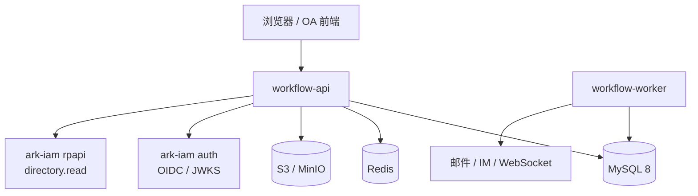
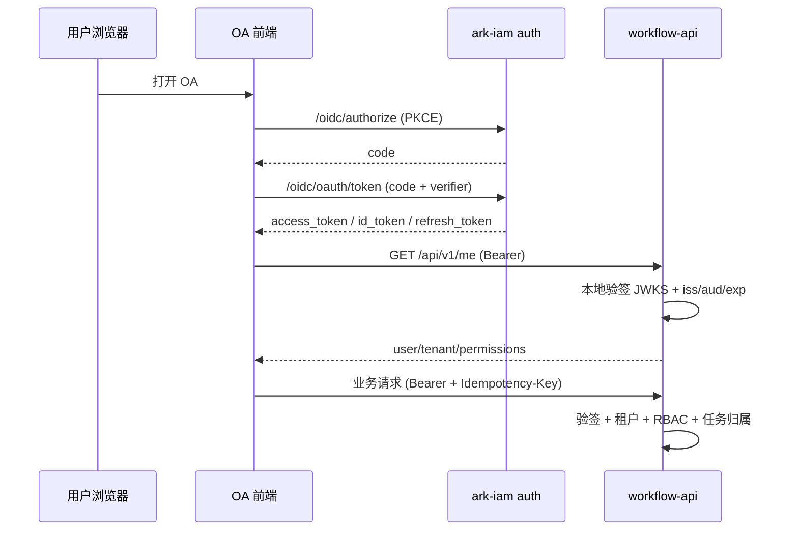
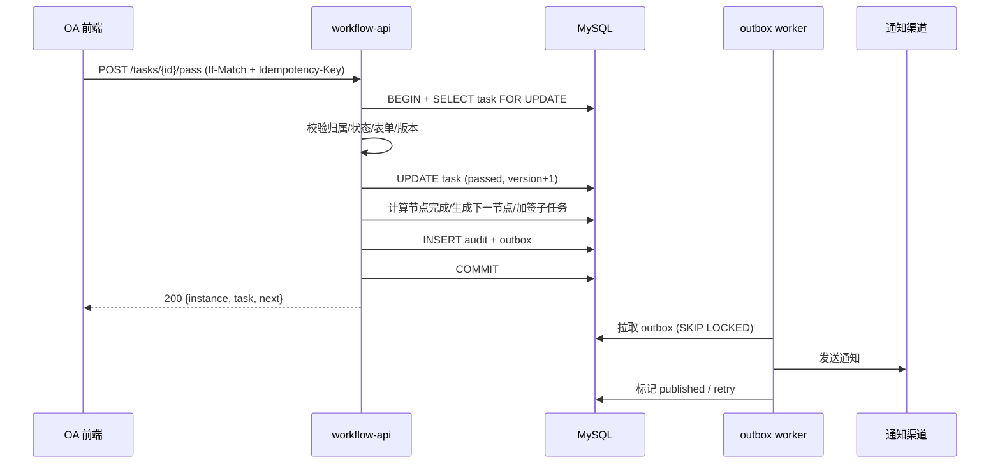
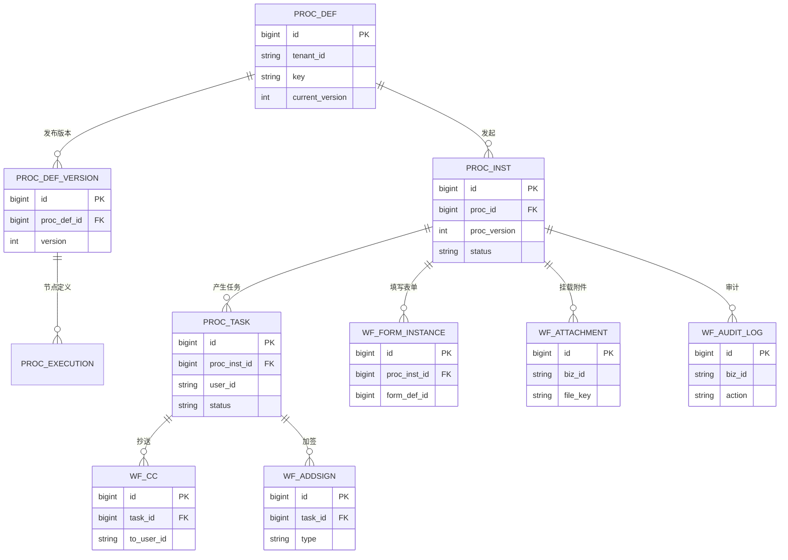
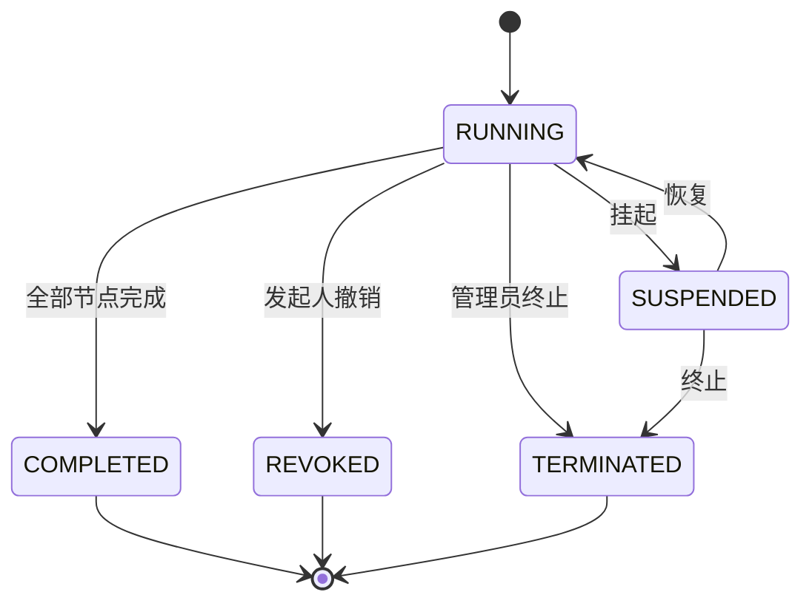

# easy-workflow OA 化改造技术方案

> 状态：草案待评 ｜ 作者：DSH（AI 助手）｜ 评审人：工作流 owner、ark-iam owner、安全/运维/前端 owner ｜ 拍板人：待定 ｜ 最后更新：2026-10-20

---

## 摘要（TL;DR）

**要做什么**：把当前“能跑通审批主流程的轻量工作流内核 + 演示型前端”升级为一套**租户感知、权限可控、可审计、可运维的 OA 审批平台**；组织、用户、角色、部门、登录与令牌全部接同级目录的 `ark-iam`，工作流不再自建账号体系。

**核心决策**：
1. 保持**模块化单体**，不拆微服务：任务提交、节点完成、下一节点生成、审计、outbox 需要强事务一致性；以当前团队规模，拆服务的收益低于运维与一致性成本。
2. **OIDC 本地验签 + 应用级 RBAC**：工作流作为 ark-iam 的 RP（Relying Party），启动时预取 JWKS，请求路径本地验签；租户/成员身份取自令牌，绝不接受请求参数指定租户。
3. **流程定义不可变版本**：发布只新增 `proc_def_version`，`proc_execution` 按 `(proc_id, version)` 保留；实例启动时钉住版本，发布新版本不影响在途实例。
4. **表单引擎与附件独立于流程变量**：表单数据存 JSON 并按版本钉住；流程变量只保留网关判断所需的轻量键值，避免把业务表单塞进 `VARCHAR(250)`。
5. **命令模型 + 幂等 + outbox**：所有写操作走“校验 → 行锁/乐观锁 → 同事务写任务/实例/审计/outbox → 提交”；外部通知由 worker 异步投递，不在事务内调用。
6. **安全表达式引擎替换 SQL 拼接**：网关条件改用 `expr-lang/expr`，变量类型化绑定，禁止把用户输入拼进 SQL。
7. **API v1 重做**：`/api/v1` JSON + 统一错误码 + 幂等键 + 分页上限；旧 `/process` 保留一个过渡期后下线。

**量化目标**（假设与口径见“约束与非功能需求”）：
- 50 个租户、10 万成员、峰值 50 QPS、5,000 实例/日、25,000 任务/日。
- 读接口 P99 ≤ 300ms，写接口 P99 ≤ 500ms，可用性 99.9%。
- 审计覆盖 100% 写命令，在线保留 3 年；跨租户数据泄露 0 例。

**成本与周期**：核心 P0–P5 约 **24–32 周**，按 3 名工程师（2 后端 + 1 前端）+ 兼职 QA/运维估算；P6 进阶能力另计 6–10 周。基础设施约 3 个 API 副本、MySQL 8、Redis、S3 兼容对象存储，月成本区间 `[待核实]`。

**需要拍板的 2 件事**：
1. ark-iam 是否允许做**加法改造**：access token 增加 `groups` 声明；目录 API 增加“成员搜索 / 角色成员 / 部门成员 / 部门负责人”端点。若不改，则改用 BFF 或 userinfo 换 session 的降级方案（见 ADR-003）。
2. 目标形态是**单租户内部 OA** 还是**多租户 SaaS**。本方案默认按多租户设计（`tenant_id` 从第一天进入数据模型），单租户只是“只有一个租户”的特例；若明确不做多租户，可删掉部分租户隔离与平台管理内容，工期约减少 10–15%。

---

## 背景与目标

### 业务背景与现状

当前仓库在 `feature/web-process-designer` 分支上，核心是上游 `easy-workflow` 引擎加一套 LogicFlow 前端：

- 引擎支持开始/任务/混合网关/结束、会签、自由驳回、直接提交给驳回我的人、转办、撤销、节点事件、计划任务。见 `workflow/engine/ProcessNode.go`、`ProcessTask.go`、`ProcessEvent.go`。
- 数据模型有 active/history 分离、`batch_code`、`business_id`、任务意见。见 `workflow/database/tables.go`。
- 前端有流程设计器、定义管理、实例中心、待办/已办、进度回显。见 `web/src/pages/`、`web/src/logicflow/convert.ts`。
- 已修复 `proc_execution` 未按 `proc_id` 过滤的串流程缺陷。见 `workflow/engine/ProcessTask.go` 中 `TaskNextNode`/`TaskUpstreamNodeList` 的 `proc_id` 条件。

但按 OA 审批系统标准，当前仍是 MVP/POC：

- **没有认证/授权**：`workflow/web_api/router/routers.go:25-43` 直接注册路由，`example/main.go:79-80` 只挂 `gin.Logger()`/`gin.Recovery()`；任何调用者拿到 `TaskID` 就能通过/驳回/转办，拿到实例 ID 就能强制撤销。
- **没有组织模型**：`Node.Roles` 只是字符串，引擎不解析，必须写节点开始事件把角色映射成 `UserIDs`；没有用户/部门/岗位/汇报关系服务。
- **没有表单/附件**：前端只有 key-value 变量编辑器；`proc_inst_variable.value` 是 `VARCHAR(250)`，无法承载真实 OA 表单。
- **没有版本隔离**：实例存了 `proc_version`，但 `GetInstanceNode` 按 `ProcID` 取当前定义，`TaskNextNode` 按 `proc_id` 查当前 `proc_execution`；发布新版本会删除并重建 `proc_execution`，在途实例会被新定义“劫持”。
- **没有审计/通知/SLA**：只有任务表的 `Comment`；事件是同步进程内回调，示例通知只是 `log.Printf`；没有操作日志、催办、超时升级。
- **并发/事务有缺陷**：`taskSubmit` 无行锁/乐观锁，`InstanceVariablesSave` 在外部事务里另开事务，`ProcCache` 是无锁 map；双击审批可能重复生成下游任务，并发启动可能触发 `concurrent map read and map write`。
- **没有后端流程校验**：`ProcessDefine.go:20` 还是 TODO；多开始节点、重复 NodeID、环、无处理人、任务多出线都能入库。

### 痛点与动因

| 痛点 | 具体场景 | 频次/影响 | 证据 |
|---|---|---|---|
| 不能上线 | 任何能访问 API 的人都能审批/撤销任意任务 | 每请求 | `routers.go:25-43` |
| 不能多租户 | 无 `tenant_id`，`source` 只能过滤定义，不能隔离实例/任务 | 持续 | `tables.go` |
| 不能交付 OA | 没有表单、附件、加签、抄送、委托、通知、审计 | 每个真实审批 | 前端页面与 API 清单 |
| 发布即事故 | 改流程定义会影响在途实例，节点改名直接报“节点不存在” | 每次发布 | `ProcessDefine.go:45-107`、`ProcessNode.go:296` |
| 数据可能错乱 | 并发审批、变量独立事务、无幂等 | 高峰期 | `ProcessTask.go:648-681` |
| 合规不达标 | 无操作审计、转办删除原任务、撤销无原因 | 每次操作 | `ProcessTask.go:255-300` |

**为什么现在做**：ark-iam 已经提供了 OIDC、租户、部门、角色、成员、API Key、目录 API 和审计能力；工作流侧继续自建账号/权限/组织是重复造轮子，且会与公司统一身份体系割裂。现在做可以把“认证/组织/权限”一次性收口，再把精力放在 OA 审批能力上。

### 目标与非目标

**业务目标**：
- 支撑公司内部（或首批租户）的请假、报销、采购、合同、用印等审批上线，替代线下/IM 审批。
- 审批全链路可追溯：谁发起、谁审批、何时、改了什么、通知了谁。
- 与 ark-iam 统一登录和组织，员工离职/调岗/角色变更即时生效。

**技术目标**：
- 所有 API 默认拒绝匿名；任务操作必须校验“当前用户是该任务处理人/代理人/授权管理员”。
- 租户隔离：任何查询/写入都带 `tenant_id`，跨租户返回 404/403，不泄露存在性。
- 流程定义版本不可变；发布新版本不改变在途实例的节点、表单、审批人解析规则。
- 写命令幂等：同一 `Idempotency-Key` 重复提交返回同一结果，不产生重复实例/任务。
- 读 P99 ≤ 300ms、写 P99 ≤ 500ms（50 QPS、100 万任务历史、2 倍峰值压测）。
- 审计 100% 覆盖写命令，支持按实例/任务/操作人/时间查询与导出。

**非目标（超出本期范畴的用例）**：
- 完整 BPMN 2.0 兼容、子流程/调用活动、边界定时事件、消息/信号事件、复杂事件处理。原因是当前引擎是轻量模型，强行 BPMN 化会推翻现有语义；放到 P6 评估。
- 原生 iOS/Android App。前端先做响应式 Web；移动端另行立项。
- 跨租户数据共享/集团多租户合并报表。当前只做租户隔离，平台级跨租户视图另行设计。
- AI 辅助审批、智能路由。需要独立的数据与模型治理，不在本期。
- 替换 ark-iam 或自建身份体系。身份/组织/角色以 ark-iam 为唯一事实源。
- 多地域双活。先做单地域高可用，异地容灾另行设计。
- 服务端发起草稿、电子签名/签章、复杂报表/BI、平台级跨租户管理台。本期先做前端本地草稿、基础统计；这些能力放到 P6 单独立项。

**假设与约束**：
- `[假设]` 50 个租户、每租户 2,000 成员、峰值 50 QPS、5,000 实例/日、25,000 任务/日；数据按 3 年保留。
- `[假设]` 部署在单地域、3 个可用区；MySQL 8 主从、Redis 主从、S3 兼容对象存储。
- `[假设]` 团队 3 人（2 后端 + 1 前端）+ 兼职 QA/运维；周期 24–32 周。
- `[待确认]` ark-iam 可以做加法改造（见 ADR-003、ADR-004）。
- `[待确认]` 可以把 Go 版本从 1.19 升到 1.26.1（ark-iam SDK 的 `go.mod` 要求）；若不能，采用本地验签实现作为过渡（见 ADR-002）。
- `[待确认]` 附件存储选 S3 兼容（开发 MinIO，生产 S3/RustFS）；合规保留期 3 年。
- `[待确认]` 是否保留旧 `/process` API 的过渡期；默认保留 2 个 release。

### 约束与非功能需求

**宿主/依赖约束**：
- ark-iam SDK（`backend/sdk`）使用 `go 1.26.1`，依赖白名单只有标准库 + `jwt/v5`；工作流模块需升 Go 版本或复制等价验签实现。
- ark-iam 的 RP 目录 API 只读、只接受 M2M 机器令牌、租户只来自令牌 `tenant_id`；目录客户端**不得**进入鉴权关键路径。
- ark-iam 的 `groups` 声明目前只在 ID token/userinfo，access token 的 `TokenClaims` 没有 `Groups` 字段（`backend/sdk/contract/claims.go:70-90`；`persistent_store.go:367-476` 只 `userinfo.AppendClaims`）。工作流后端要本地做 RBAC，必须补 access token `groups` 或走 session/BFF。
- 现有 RP 目录只有 4 个端点：成员按 ID/批量、部门树、角色清单（`backend/apps/rpapi/internal/router/router.go:55-61`）；没有“成员搜索 / 角色成员 / 部门成员 / 部门负责人”，需要补。
- ark-iam 有 `department_user.relation_type='leader'`（`backend/pkg/model/department_user.go:17-20`），但没有个人级 `manager_user_id`；“上级审批”默认按“主部门负责人（若本人是负责人则逐级向上）”解析。

**量化非功能目标**：
- 可用性 99.9%（月度停机 ≤ 43.8 分钟）。依赖预算：工作流 API 99.95%、MySQL 99.95%、ark-iam 99.9%、对象存储 99.9%；ark-iam 登录不可用时，已登录用户的本地验签仍可用（JWKS 缓存），目录不可用时姓名/部门降级为快照/ID，不阻塞审批。
- 读 P99 ≤ 300ms、写 P99 ≤ 500ms；50 QPS 常态、100 QPS 峰值（2 倍压测）。
- 审计写入成功率 ≥ 99.99%；outbox 投递延迟 P99 ≤ 30s；SLA 扫描误差 ≤ 1 分钟。
- 容量：活跃实例 5 万、活跃任务 25 万、历史任务 500 万/年、审计 2,000 万/年；附件 500GB/年（假设平均 100KB/附件、5,000 附件/日）。
- 数据保留：审计 3 年、历史实例/任务 2 年在线 + 冷备 3 年、附件 3 年。

### 验收标准

| 验收项 | 谁验 | 怎么验 | 阈值 |
|---|---|---|---|
| 认证覆盖 | 安全/后端 | 遍历路由表 + 匿名请求扫描 | 100% 业务路由 401/403，无匿名可写 |
| 越权防护 | 安全/QA | 任务归属、实例归属、跨租户、管理员覆盖矩阵 | 0 越权；跨租户返回 404/403 |
| 版本隔离 | 后端/QA | 发布新版本/改节点名，在途实例继续按旧版本完成 | 在途实例 100% 不受影响 |
| 幂等 | 后端/QA | 同一 Idempotency-Key 并发 10 次 | 只产生 1 个实例/1 次状态变更 |
| 表单/附件 | 产品/QA | 请假/报销样例端到端 | 必填校验、附件上传下载、只读/可编辑字段正确 |
| 加签/抄送/委托 | 产品/QA | 前加签、后加签、会签、或签、依次、比例、委托代理 | 语义符合本文规则，审计完整 |
| 通知/SLA | 运维/QA | 任务分配、催办、超时升级、outbox 重试 | P99 ≤ 30s；重复投递不重复通知 |
| 审计 | 合规/QA | 每个写命令产生审计；查询/导出 | 覆盖率 100%；关键字段可追溯 |
| 性能 | 后端/运维 | k6 2 倍峰值 30 分钟 | P99 达标、错误率 < 0.1% |
| 迁移 | DBA/后端 | 全量+增量、行数/校验和对账 | 0 丢失；差异可解释 |
| 回滚 | 运维/后端 | 开关回退、旧版本读取新数据 | 30 分钟内恢复；不丢已提交数据 |

---

## 总体架构设计

### 架构设计原则

1. **租户优先**：`tenant_id` 是数据隔离第一维；任何仓储方法必须显式接收租户上下文，禁止“默认全表”。
2. **定义不可变**：流程定义、表单定义发布后不可修改，只能新增版本；实例钉住版本。
3. **命令与查询分离**：写命令走聚合根 + 事务 + 审计 + outbox；读查询走轻量 SQL/索引，不触发副作用。
4. **事务内不做外部调用**：通知、目录、对象存储元数据同步都通过 outbox/worker 或提交后异步处理。
5. **本地验签、最小依赖**：请求路径只验 JWT（JWKS 缓存），不访问 ark-iam；目录只用于展示与审批人解析，失败可降级。
6. **默认拒绝**：没有明确权限的动作一律拒绝；管理员覆盖必须带原因并写审计。
7. **可审计**：所有状态变更、权限变更、定义发布、加签/转办/撤销都有不可变审计记录。
8. **渐进式改造**：先加护栏和兼容层，再替换；每个阶段可独立上线、可回退。

### 系统上下文与依赖



- **workflow-api**：Gin HTTP 服务，负责认证、鉴权、流程命令、查询、目录代理、附件签名。
- **workflow-worker**：同一二进制的 `worker` 子命令，负责 outbox 投递、SLA 扫描、超时升级、附件清理；通过 MySQL 行锁/Redis 锁选主，可多副本。
- **MySQL 8**：流程定义/版本/实例/任务/表单/审计/outbox/通知；工作流唯一事实源。
- **Redis**：缓存（权限、目录、定义热数据）、分布式锁、限流、会话撤销 denylist；不是事实源。
- **S3/MinIO**：附件二进制；数据库只存元数据与对象 key。
- **ark-iam auth**：OIDC issuer、JWKS、token、logout；工作流只验签，不共享数据库。
- **ark-iam rpapi**：只读目录（成员/部门/角色）；工作流用 API Key 换 M2M token，`directory.read`。

### 总体架构

总体形态是“无状态 API + 可选 worker + MySQL/Redis/S3 + ark-iam 两个入口（auth/rpapi）”；模块职责与数据所有权见下表，部署拓扑见“部署与资源拓扑”。

**模块职责与数据所有权**：

| 模块 | 职责 | 写入的表 | 只读的表/外部 |
|---|---|---|---|
| `api` | HTTP 路由、DTO、参数校验、错误映射、OpenAPI | 无 | 所有服务 |
| `auth` | OIDC 验签、身份上下文、租户校验、权限判定 | 无 | ark-iam JWKS |
| `iam` | ark-iam 适配：目录客户端、成员/部门/角色解析、角色→权限映射 | `wf_role_permission` | ark-iam rpapi |
| `engine` | 流程定义解析/校验、实例/任务状态机、节点流转、版本钉住 | `proc_def*`、`proc_execution`、`proc_inst`、`proc_task`、`proc_inst_variable` | 无 |
| `form` | 表单定义/版本、表单数据、字段权限、校验 | `wf_form_*` | `proc_inst` |
| `task` | 任务命令：通过/驳回/转办/加签/抄送/委托/撤回 | `proc_task`、`wf_addsign`、`wf_cc`、`wf_delegation` | `proc_inst` |
| `audit` | 审计写入/查询/导出 | `wf_audit_log` | 所有模块 |
| `notify` | outbox、通知模板、渠道投递、SLA 扫描 | `wf_outbox`、`wf_notification`、`wf_sla_rule` | `proc_task` |
| `admin` | 租户设置、权限映射、分类、委派、SLA 配置 | `wf_tenant_setting`、`wf_role_permission`、`wf_sla_rule`、`wf_delegation` | ark-iam directory |

**数据所有权边界**：
- 工作流拥有流程、实例、任务、表单、附件元数据、审计、通知；ark-iam 拥有用户、自然人、租户、部门、角色、成员关系、凭证、会话。
- 不做跨库 JOIN；展示用姓名/部门在写入时**快照**（`starter_name_snapshot`、`user_name_snapshot`、`dept_name_snapshot`），历史不随组织变更而变。
- 附件二进制归对象存储；工作流存 `file_key`、`etag`、`size`、`mime`、`checksum`。

### 核心流程

**登录与鉴权**：



**审批通过 + 加签 + outbox**：



**流程定义发布**：发布流程见下文“流程定义与版本”的 1–5 步；关键点是**新版本只插入 `proc_def_version`、不删除旧版本/旧执行行**，在途实例继续按 `proc_inst.proc_version` 读取。

### 数据流转

1. **发起**：前端提交表单 JSON + `BusinessID` + `Idempotency-Key` → 校验表单/定义版本/租户/权限 → 创建 `proc_inst`（钉住 `proc_version`）、`wf_form_instance`、`proc_task`（开始节点自动完成）→ 写 `proc_inst_variable`（供网关）、`wf_audit_log`、`wf_outbox` → 提交。
2. **审批**：任务命令 → 锁任务 → 校验归属/状态/表单字段权限 → 更新任务 → 评估节点完成（会签/或签/依次/比例/加签）→ 生成下一节点任务或结束实例 → 审计/outbox → 提交。
3. **通知**：worker 拉 outbox → 渲染模板 → 写 `wf_notification` → 调邮件/IM/WebSocket → 标记状态；失败退避重试，超过上限进 dead letter。
4. **查询**：待办/已办/抄送/我的发起/实例详情/时间线 → 走覆盖索引；姓名/部门优先读快照，缺失时批量查目录（缓存 60s/300s）。
5. **附件**：前端请求上传票据 → 后端校验权限/大小/类型 → 返回预签名 URL → 前端直传对象存储 → 回调/确认写 `wf_attachment`；下载时后端鉴权后返回短期预签名 URL。

### 部署与资源拓扑

| 组件 | 副本 | 资源（假设） | 说明 |
|---|---|---|---|
| workflow-api | 3 | 2C4G × 3 | 无状态；滚动发布；HPA 按 CPU/QPS |
| workflow-worker | 2 | 1C2G × 2 | 同二进制 `worker` 子命令；DB/Redis 选主 |
| MySQL 8 | 1 主 + 1 从 | 4C16G，500GB SSD | 主写从读；备份/PITR；审计/历史可归档 |
| Redis | 1 主 + 1 从 | 2GB | 缓存/锁/限流；非事实源 |
| S3/MinIO | 托管 | 1TB 起 | 附件；生命周期/版本控制 |
| ark-iam | 既有 | 既有 | auth/rpapi；TLS + 内网访问 |

- 网络：浏览器 → Ingress（TLS）→ workflow-api；workflow-api → MySQL/Redis/S3/ark-iam 均走内网/TLS；ark-iam 出站仅允许 HTTPS。
- 环境：dev（MinIO/本地 MySQL）、staging（与生产同构、假 OIDC/测试租户）、prod。
- 发布：API 滚动；worker 先停后起或滚动（outbox 幂等）；迁移作为独立 Job，先于 API。

---

## 方案与选型对比

### 备选方案

| 方案 | 做法 | 代价 | 结论 |
|---|---|---|---|
| A. 在现有引擎上增量改造（**选中**） | 保留 Go 引擎与 MySQL，补 IAM/表单/版本/审计/通知 | 需要重构事务与数据模型；历史包袱 | 复用已有流程语义与前端设计器；风险可控 |
| B. 重写到 BPMN 引擎（Camunda/Temporal） | 用成熟引擎替换核心 | 迁移成本高；中国式自由驳回/直接提交需二次开发；团队学习曲线 | 不选；现有引擎已覆盖目标语义，重写不解决问题 |
| C. 拆微服务（定义/任务/表单/通知） | 按领域拆服务 | 分布式事务、链路、运维复杂度；团队规模不足 | 不选；50 QPS/3 人团队不划算；P6 再评估 |
| D. 采购 SaaS OA | 直接买 | 数据驻留、定制、集成、长期成本 | 不选；无法与 ark-iam/内部系统深度集成 |
| E. 维持现状 | 只修 bug | 无认证/无组织/无表单，不能上线 | 不选；安全与合规不可接受 |

**Y-statement**：在“需要 OA 审批上线、已有 Go 引擎与 ark-iam”的场景下，面对“交付速度 vs 一致性与运维复杂度”的关切，我们选择**增量改造的模块化单体**，放弃重写 BPMN 与拆微服务，以获得复用现有流程语义、强事务一致性和 3 人团队可维护性，接受“需要自己补表单/审计/通知”的代价；当租户/QPS 增长 10 倍或团队拆成多个独立交付组时，再评估拆分。

### 技术选型对比

| 领域 | 选项 | 选择 | 理由与代价 | 什么情况下不该选 |
|---|---|---|---|---|
| 身份/令牌 | A. OIDC 本地验签 + access token `groups`；B. BFF + userinfo/session；C. 共享 ark-iam DB/Redis | **A**（B 为降级） | 无状态、请求路径不依赖 ark-iam；需要 ark-iam 加法改造 | 不能改 ark-iam 且合规要求服务端会话时选 B |
| 表达式 | A. `expr-lang/expr`；B. CEL；C. govaluate；D. 继续 SQL | **A** | 语法友好、可编译缓存、类型化环境；比 CEL 轻 | 需要强类型/策略生态时选 CEL；禁止 D |
| 表单渲染 | A. Formily + AntD；B. RJSF；C. 自研 | **A** | 复杂联动/校验/布局成熟，和 AntD 契合；包体与学习成本 | 字段 <10 且无联动时自研更轻 |
| 存储 | A. MySQL 8 + S3；B. PostgreSQL + S3；C. MongoDB | **A** | 现有引擎/CTE/GORM 已用 MySQL；团队熟悉；S3 存附件 | 要与 ark-iam 同库/需要 JSONB 高级查询时选 B |
| 迁移 | A. goose；B. golang-migrate；C. AutoMigrate | **A** | SQL 可审、可嵌入、Up/Down；不依赖应用启动 | 只做单机 Demo 可用 C；生产禁止 |
| 异步 | A. MySQL outbox + worker；B. Kafka/RabbitMQ；C. 进程内 goroutine | **A** | 与业务同事务、无新增中间件；吞吐 50 QPS 足够 | 峰值 >5k msg/s 或跨团队消费时选 B |
| 前端登录 | A. 公共客户端 + PKCE；B. BFF + HttpOnly Cookie | **A** | 与 ark-iam 内置控制台一致；无需会话服务；短 TTL + 轮换 | 合规禁止浏览器持有 token 时选 B |
| 附件 | A. S3 预签名直传；B. 后端中转 | **A** | 减轻 API 带宽/内存；需对象存储与回调 | 附件 <10MB 且无对象存储时 B 更简单 |

### 选型风险与回退路径

- **ark-iam 改造未获批**：退回 BFF/session 方案（见 ADR-003），工期 +2–3 周；或先用 `userinfo` 在登录时取 `groups`，写 Redis 会话，后端按 session 鉴权（有状态，需额外 Redis 与登出同步）。
- **Go 1.26 不可用**：复制 `sdk/contract` + `sdk/rp` 的验签逻辑到 `workflow/iam/local`（约 200 行，保留版权与测试），或发布兼容版本的 SDK；不要直接依赖旧版 `golang-jwt` 自行解析而不校验 `iss/aud/kid`。
- **表达式引擎不满足需求**：先用 `expr` 覆盖比较/逻辑/括号/字符串/数字/日期；若需要复杂函数，注册白名单函数；仍不满足再评估 CEL。
- **表单引擎过重**：先用 Formily 渲染 + 自研 schema 设计器；若包体/学习成本超预期，退回自研 10 种字段的渲染器（代价是联动能力弱）。
- **MySQL 容量/查询瓶颈**：先加索引/归档/读写分离；若仍不足，再评估分库分表或 PostgreSQL，不在本期。

---

## 详细技术设计

### 模块划分与职责

建议的包结构（渐进式迁移，不要求一次性搬完）：

```
workflow/
  api/            # Gin 路由、DTO、错误映射、OpenAPI
  auth/           # OIDC 验签、identity context、tenant、permission
  iam/            # ark-iam SDK 适配、directory client、role→permission
  engine/         # 现有引擎：定义、实例、节点、任务（逐步拆出 domain/store）
  form/           # 表单 schema、校验、字段权限、渲染模型
  task/           # 任务命令：pass/reject/transfer/add-sign/cc/delegate
  audit/          # 审计写入/查询/导出
  notify/         # outbox、模板、渠道、SLA
  admin/          # 租户设置、权限映射、分类、委派、SLA 配置
  store/          # GORM repositories、事务、迁移
  worker/         # worker 子命令
  cmd/            # api/worker/migrate 入口
```

- 现有 `workflow/engine` 继续作为领域核心，但**禁止**在 handler 里直接调用全局 `DB`；逐步改为 `Service` + `Repository`，所有方法接收 `context.Context` 与 `TenantID`。
- 保持库的可嵌入性：`engine` 对外暴露接口，`web_api` 只是适配器；如果宿主系统要嵌入，可复用 `auth`/`engine`/`form` 包，不强制起 HTTP 服务。
- 事务边界：`store.Tx(ctx, func(tx) error)`；所有 repository 方法接受 `tx`，禁止内部 `DB.Begin()`。

### 接口设计

**约定**：
- 前缀 `/api/v1`；JSON；`Content-Type: application/json`。
- 成功：HTTP 2xx + `{ "data": ..., "requestId": "..." }`；失败：HTTP 4xx/5xx + `{ "code": "WF_XXX", "message": "...", "requestId": "...", "details": ... }`。
- 认证：`Authorization: Bearer <access_token>`；M2M 目录代理由服务端持有 API Key，不暴露给浏览器。
- 租户：从 token `tenant_id` 取；请求体/query 不允许指定租户；缺少 `tenant_id` 返回 403。
- 幂等：所有 POST/PUT/PATCH 接受 `Idempotency-Key`；同一 key + 不同 body 返回 409；结果缓存 24h。
- 并发：任务/定义更新接受 `If-Match: <version>` 或 body `version`；冲突返回 409。
- 分页：`page`（默认 1）、`pageSize`（默认 20，最大 100）；返回 `total`；审计/通知支持 `cursor`。
- 排序：白名单字段；禁止任意 `ORDER BY` 拼接。
- 超时/大小：API 请求体 ≤ 10MB（附件走预签名，不占 API）；单次批量 ≤ 100。
- 版本：`/api/v1` 破坏性变更升 `/api/v2`；旧 `/process` 标记 `Deprecation`/`Sunset`，过渡 2 个 release。

**端点清单（节选）**：

| 方法 | 路径 | 权限 | 说明 |
|---|---|---|---|
| GET | `/api/v1/me` | 登录 | 当前用户/租户/权限 |
| GET | `/api/v1/directory/members` | `workflow.def.write` 或 `workflow.task.act` | 成员搜索（keyword/departmentId/roleCode） |
| GET | `/api/v1/directory/departments/tree` | 同上 | 部门树 |
| GET | `/api/v1/directory/roles` | 同上 | 角色清单 |
| GET | `/api/v1/directory/roles/{code}/members` | 同上 | 角色成员（审批人解析） |
| GET | `/api/v1/directory/departments/{id}/leaders` | 同上 | 部门负责人 |
| GET/POST | `/api/v1/defs` | `workflow.def.read/write` | 定义列表/创建草稿 |
| GET/PUT | `/api/v1/defs/{id}` | `workflow.def.read/write` | 详情/更新草稿 |
| POST | `/api/v1/defs/{id}/validate` | `workflow.def.write` | 结构/表达式校验 |
| POST | `/api/v1/defs/{id}/publish` | `workflow.def.publish` | 发布不可变版本 |
| POST | `/api/v1/defs/{id}/disable` | `workflow.def.publish` | 停用（新实例不可发起） |
| GET | `/api/v1/defs/{id}/versions` | `workflow.def.read` | 版本历史 |
| GET/POST | `/api/v1/forms` | `workflow.def.write` | 表单定义/草稿 |
| POST | `/api/v1/forms/{id}/publish` | `workflow.def.publish` | 发布表单版本 |
| POST | `/api/v1/instances` | `workflow.instance.start` | 发起（幂等） |
| GET | `/api/v1/instances` | `workflow.instance.read.own/tenant` | 我的/租户实例 |
| GET | `/api/v1/instances/{id}` | 归属/租户权限 | 详情 + 时间线 |
| POST | `/api/v1/instances/{id}/revoke` | `workflow.instance.revoke.own/any` | 撤销（原因） |
| POST | `/api/v1/instances/{id}/terminate` | `workflow.instance.revoke.any` | 终止 |
| POST | `/api/v1/instances/{id}/suspend` | `workflow.admin` | 挂起/恢复 |
| GET | `/api/v1/tasks/todo` | 登录 | 我的待办 |
| GET | `/api/v1/tasks/done` | 登录 | 我的已办 |
| GET | `/api/v1/tasks/cc` | 登录 | 抄送我的 |
| GET | `/api/v1/tasks/{id}` | 归属/管理员 | 任务详情 + 可执行动作 |
| POST | `/api/v1/tasks/{id}/pass` | 任务归属/代理 | 通过（幂等 + If-Match） |
| POST | `/api/v1/tasks/{id}/reject` | 任务归属/代理 | 驳回（上一节点/指定上游） |
| POST | `/api/v1/tasks/{id}/transfer` | 任务归属/代理 | 转办（留痕） |
| POST | `/api/v1/tasks/{id}/add-sign` | 任务归属/代理 | 前/后加签 |
| POST | `/api/v1/tasks/{id}/withdraw` | 任务归属 | 撤回自己的通过（窗口内） |
| POST | `/api/v1/tasks/batch` | 任务归属/代理 | 批量通过/驳回 |
| POST | `/api/v1/instances/{id}/cc` | 发起人/管理员 | 手动抄送 |
| POST | `/api/v1/instances/{id}/comments` | 参与人 | 评论 |
| POST | `/api/v1/attachments/ticket` | 参与人 | 获取上传票据 |
| GET | `/api/v1/attachments/{id}/url` | 参与人 | 短期下载 URL |
| GET | `/api/v1/admin/audit` | `workflow.audit.read` | 审计查询/导出 |
| GET/POST | `/api/v1/admin/delegations` | `workflow.admin` | 委托规则 |
| GET/POST | `/api/v1/admin/sla` | `workflow.admin` | SLA 规则 |
| GET/POST | `/api/v1/admin/permissions` | `workflow.admin` | 角色→权限映射 |

**示例：发起实例**：

```http
POST /api/v1/instances
Authorization: Bearer <token>
Idempotency-Key: 1f0c...
Content-Type: application/json

{
  "processId": "1024",
  "businessId": "LEAVE-2026-0001",
  "form": {"leaveType": "annual", "days": 3, "reason": "..."},
  "attachments": ["att_01"],
  "comment": "请批准"
}
```

```json
{
  "data": {
    "instanceId": "9001",
    "status": "RUNNING",
    "currentNode": "Manager",
    "tasks": [{"taskId": "7001", "assignee": "u_123", "node": "Manager"}]
  },
  "requestId": "req_..."
}
```

**示例：审批通过（乐观锁 + 幂等）**：

```http
POST /api/v1/tasks/7001/pass
Authorization: Bearer <token>
Idempotency-Key: 6a2e...
If-Match: "3"
Content-Type: application/json

{"comment": "同意", "form": {"days": 3}}
```

- 409：任务已被他人处理/版本冲突；返回最新任务状态，前端刷新。
- 403：不是任务处理人/代理人/授权管理员。
- 422：表单字段校验失败；返回字段级错误。

### 认证与授权

**OIDC 接入**：
- 工作流在 ark-iam 创建应用 `easy_workflow`（`AppCodePattern`：小写字母/数字/下划线）与客户端：
  - `workflow_web`：public client，`authorization_code` + `refresh_token`，`tokenEndpointAuthMethod=none`，`requirePKCE=true`，`redirectURIs` 指向 `/oidc/callback`，`backChannelLogoutURI` 指向 `/api/v1/auth/back-channel-logout`。
  - `workflow_api`：API Key（机器主体）用于目录读取，scope `directory.read`，`resource`/aud 指向 `rpapi` 的 client_id。
- 后端配置：`OIDC_ISSUER`（如 `https://iam.example.com/oidc`）、`OIDC_AUDIENCE=workflow_web`、`OIDC_JWKS`（可选显式端点）、`OIDC_LEEWAY=30s`。
- 验签：使用 `ark-iam/sdk/rp`（`rp.NewKeys` + `rp.NewVerifier`）；启动时预取 JWKS，失败则 fail-closed 不启动；请求路径只按 `kid` 查内存公钥；拒绝 `jwk`/`jku`/`x5u` 头；仅 RS256；校验 `iss`/`aud`/`exp`/`nbf`。
- 身份：`Identity{TenantID, UserID, PersonID, ClientID, IsMachine, SessionID, Scopes, Groups, ActorID}`；`UserID` 是 `tenant_user.id`，写审计用；`PersonID` 用于自然人维度；`TenantID` 必须非空（否则 403）。
- 多租户自然人：令牌可能因“自然人→租户映射不唯一”不带 `tenant_id`；前端在登录后调用 ark-iam 的“我的租户”能力让用户选择，再走租户作用域的授权/换 token；工作流不猜测默认租户，缺 `tenant_id` 一律 403。
- 会话/登出：前端登出调用 ark-iam end-session；后端接收 back-channel logout，将 `sid` 写入 Redis denylist（TTL = token 剩余时间），本地验签后检查 denylist；高危操作（管理员、强制撤销）可选 introspection 二次确认。
- Redis 不可用时：默认接受“已本地验签且未过期”的 token（fail-open）并告警，登出延迟窗口 ≤ token TTL；高合规租户可配置 fail-closed（拒绝所有请求），需在租户设置中明确。
- 降级：ark-iam auth 不可用时，已缓存 JWKS 的 token 仍可验签；JWKS 不可用且无缓存 → 503，不伪装 401。

**RBAC**：
- `groups` 声明（access token 新增）→ 角色编码；角色编码由 ark-iam 应用角色模板定义（`workflow_admin`、`workflow_designer`、`workflow_approver`、`workflow_viewer`、`workflow_auditor`）。
- 工作流维护 `wf_role_permission(tenant_id, role_code, permission_code)`；默认映射由迁移种子写入，租户管理员可调整（需 `workflow.admin`）。
- 权限粒度：
  - `workflow.def.read/write/publish`
  - `workflow.instance.start`
  - `workflow.instance.read.own/tenant`
  - `workflow.task.read.own`, `workflow.task.act`
  - `workflow.instance.revoke.own/any`
  - `workflow.audit.read`
  - `workflow.admin`
- 任务级授权：`task.user_id == identity.user_id` 或 `task.owner_user_id == identity.user_id`（委托场景）或 `identity` 有 `workflow.task.act.admin` + 原因；管理员覆盖写审计。
- 实例级授权：`starter == identity.user_id` 或 `workflow.instance.read.tenant` / `revoke.any`。
- 定义级授权：`owner_user_id == identity.user_id` 或 `workflow.def.publish`；租户隔离由 `tenant_id` 强制。
- 机器身份：目录/同步任务使用 `IsMachine` + scope；机器身份不能审批自然人任务，除非显式服务账号授权。

**ark-iam 需要的加法改造**（详见 ADR-003/004）：
1. **access token 增加 `groups`**：在 `TokenClaims` 增加 `Groups []string`，`OIDCPrivateClaims` 写入；签发 access token 时复用 `appendRoleGroupClaims` 的角色计算（按 client 所属 app 裁剪）。这样后端可本地 RBAC，不需要 userinfo/会话。
2. **目录 API 增加**：
   - `GET /v1/rp/directory/members/search?keyword=&departmentID=&roleCode=&page=&pageSize=`（成员搜索，返回 `userID/name/avatar/status/userType/departmentNames`）。
   - `GET /v1/rp/directory/roles/{code}/members`（角色成员，分页）。
   - `GET /v1/rp/directory/departments/{id}/members`（部门成员，分页）。
   - `GET /v1/rp/directory/departments/{id}/leaders`（部门负责人；或部门树节点增加 `leaderUserIDs`，字段只增不改）。
   - 所有端点保持 `directory.read` + `tenant_id` 来自令牌、租户隔离、404 防枚举、分页上限 ≤100。
3. **角色模板**：为 `easy_workflow` 应用声明 `workflow_admin/designer/approver/viewer/auditor` 模板；开通应用的租户自动物化角色。
4. **Back-channel logout**：已有能力，工作流按 SDK 接入；无需改 ark-iam。

**目录代理与降级**：
- 浏览器不直连 rpapi，不持有 M2M token；workflow-api 暴露 `/api/v1/directory/*`，内部用 API Key 换 token + `directory.New` 客户端，TTL 缓存（成员 60s、部门/角色 300s），401/403/404 透传，连接失败/5xx 可用 stale ≤5 分钟。
- 目录只用于展示/选人；**绝不用 `Member.Status` 做放行/拒绝**；是否可登录由令牌签发侧决定。
- 写入时快照姓名/部门；目录不可用时列表显示快照/ID，不阻塞审批。

**审批人解析（Assignee Resolver）**：
- 规则类型：
  - `user`：指定成员 ID（目录选择器）。
  - `role`：角色编码 → `/directory/roles/{code}/members`，排除发起人/去重。
  - `department_leader`：部门 ID → `/directory/departments/{id}/leaders`；缺省用主部门。
  - `starter`：`$starter`（发起人 tenant_user.id）。
  - `starter_department_leader`：发起人主部门负责人；若发起人是负责人，逐级向上。
  - `form_field`：表单字段中的用户/部门 ID（校验属于本租户）。
  - `expression`：安全表达式（如 `amount > 10000 ? role("finance_director") : role("finance")`），限制在白名单函数/变量。
- 解析在**节点进入时**执行，结果写入 `proc_task`；解析失败按配置“阻塞并告警”或“转交管理员”，不能静默跳过。
- 去重/排序：按用户 ID 去重；依次审批按规则顺序；会签/或签按节点 `approve_mode`。

### 租户开通与成员变更

- **开通**：租户在 ark-iam 订阅 `easy_workflow` 应用后，工作流按 `tenant_id` 幂等初始化：默认角色→权限映射（`workflow_admin/designer/approver/viewer/auditor`）、默认 SLA/通知设置、默认分类；初始化失败不回滚 ark-iam 订阅，但工作流侧返回可重试错误。
- **懒初始化**：首个带 `tenant_id` 的请求若发现未初始化，则在事务中补齐默认配置；并发用唯一键/行锁保证只初始化一次。
- **成员停用/离职**：ark-iam 停止签发新 token；工作流不依赖目录 `Member.Status` 做鉴权。已分配任务保留，管理员可改派/终止；SLA 可升级到部门负责人。审计保留原处理人。
- **角色变更**：`groups` 在下次 token 刷新时生效；工作流权限缓存 TTL 60s；紧急撤权可通过 back-channel logout/Redis denylist 让旧 token 失效。
- **租户停用**：所有 API 返回 403；worker 跳过该租户；数据保留，等待恢复或归档。
- **平台级运维**：本期不做跨租户管理台；平台运维通过独立 API Key/脚本 + 审计执行，范围与权限单独评审（开放问题 Q10）。

### 流程定义与版本

**模型**：
- `proc_def`：定义头（租户/应用/key/名称/分类/状态/当前版本/owner）。
- `proc_def_version`：不可变版本（`version`、`resource` JSON、`checksum`、`status`、`published_at/by`）。
- `proc_execution`：按 `(tenant_id, proc_id, proc_version)` 保存节点与边；发布新版本只插入新行，不删除旧行。
- `proc_inst`：启动时写入 `proc_version`；所有 `GetInstanceNode`/`TaskNextNode`/上游查询都按 `(proc_id, proc_version)` 读取。
- 缓存：`map[tenantID]map[procID]map[version]ProcNodes` + `sync.RWMutex`/singleflight；发布时只失效新版本相关 key，不删除旧版本。

**发布流程**：
1. 设计器保存草稿（`proc_def` + `resource` 草稿字段/草稿表）。
2. `validate`：JSON schema + 图结构校验（唯一开始/结束、NodeID 唯一、边/前驱一致、从开始可达、无环、任务节点有处理人/规则、任务单出线、网关条件合法、表达式可编译、表单绑定存在）。
3. `publish`：计算 checksum → 事务插入 `proc_def_version` → 更新 `proc_def.current_version` → 写审计/outbox → 失效缓存。
4. 停用/归档：不删除版本；新实例不可用停用定义；在途实例继续。
5. 在途实例升级：默认不升级；管理员可对单个实例执行“迁移到新版本”，需节点映射/表单兼容校验，写审计；失败可回滚到旧版本（旧版本仍在）。

**向后兼容**：
- 旧代码读 `proc_def.resource`：发布时同步更新 `proc_def.resource` 为最新版本（过渡期双写），保证旧二进制可读；新代码优先读 `proc_def_version`。
- 旧 `proc_execution` 无版本行：迁移时为当前版本回填 `proc_version=current_version`；新发布不再删除。
- 旧实例 `proc_version` 可能为 0：迁移时回填为启动时版本或当前版本；标记 `legacy`。

### 表单引擎

**Schema**（示例）：

```json
{
  "version": 1,
  "fields": [
    {"key": "leaveType", "type": "select", "label": "请假类型", "required": true,
     "options": [{"label": "年假", "value": "annual"}, {"label": "事假", "value": "personal"}]},
    {"key": "days", "type": "number", "label": "天数", "required": true, "min": 0.5, "max": 30},
    {"key": "reason", "type": "textarea", "label": "事由", "required": true, "maxLength": 500},
    {"key": "attachments", "type": "attachment", "label": "附件", "maxCount": 5}
  ],
  "layout": [{"type": "row", "fields": ["leaveType", "days"]}, {"type": "row", "fields": ["reason"]}],
  "rules": [
    {"field": "days", "op": ">", "value": 3, "effect": "require", "target": "managerApproval"}
  ]
}
```

- 字段类型：text、textarea、number、amount、date、datetime、select、multiSelect、radio、checkbox、user、department、attachment、table（子表）、richText、static。
- 校验：服务端用 schema + 自定义规则；客户端同规则渲染；字段级错误返回 `{field, code, message}`。
- 字段权限：按节点配置 `editableFields`/`readonlyFields`/`hiddenFields`；默认发起人可编辑全部，审批人只读或可编辑指定字段；审批人修改写审计（before/after）。
- 表单版本：实例钉住 `form_version`；发布新表单不影响旧实例；旧实例只读时用旧版本渲染。
- 表单数据：`wf_form_instance.data_json`；需要网关判断的字段同步到 `proc_inst_variable`（类型化：string/number/bool/date/json），变量名由表单字段映射配置。
- 子表：JSON 数组；复杂查询/汇总走报表/ETL，不在 OLTP 做全表 JSON 扫描。
- 表单设计器：Formily schema + 自定义属性面板；支持字段、布局、校验、联动、节点权限；保存草稿/发布版本。

### 任务引擎

**状态**：
- 实例：`RUNNING(0) / COMPLETED(1) / REVOKED(2) / TERMINATED(3) / SUSPENDED(4)`；草稿不入实例表。
- 任务：`PENDING(0) / PASSED(1) / REJECTED(2) / TRANSFERRED(3) / WITHDRAWN(4) / SKIPPED(5) / EXPIRED(6) / CANCELLED(7)`；`is_finished` 保留兼容，新代码以 `status` 为准。
- 节点完成规则由 `approve_mode` 决定：
  - `any`（或签）：任一人通过即完成；其他人任务标记 `SKIPPED`；任一人驳回即驳回。
  - `all`（会签）：全部通过才完成；任一人驳回即驳回；其他人 `SKIPPED`。
  - `sequential`（依次）：按 `sequence_no` 逐个生成；当前通过后生成下一个；任一驳回即驳回。
  - `percentage`（比例）：`pass_threshold`（通过人数/比例）达到即通过；`reject_threshold`/一票否决按配置；未达阈值继续等待。
- 加签：
  - 前加签：为当前任务创建 `task_kind=add_before` 的子任务；父任务 `blocked=1`，子任务全部通过后解阻；任一子任务驳回，父任务按驳回处理（或按配置退回加签人）。
  - 后加签：父任务通过后创建 `task_kind=add_after` 子任务；节点需等子任务全部通过才算完成；任一驳回，节点驳回。
  - 加签子任务默认按“全部通过”处理，不受节点 `approve_mode` 影响；写 `wf_addsign` 记录操作人/原因/类型。
  - 防止递归加签：最大层级/次数配置（默认 3 层/10 人）。
- 抄送：节点配置 `cc`（用户/角色/部门/发起人上级）+ 手动抄送；写 `wf_cc`；抄送只读，可评论？默认只读+可查看，评论权限可配。
- 委托：`wf_delegation` 规则（委托人/代理人/时间/范围）；任务解析时若命中，创建任务给代理人，`owner_user_id=委托人`；委托人和代理人都可操作，审计记录 `actor` 与 `owner`；委托到期后新任务不再委托，已生成任务可选择回退/保留（配置）。
- 转办：不删除原任务；将原任务置 `TRANSFERRED` + 新任务给目标人，写 `wf_transfer`/审计；保留原处理人/时间/原因。
- 撤回：处理人在下一节点产生任务前可撤回自己的通过；若下一节点已产生任务且未处理，撤回时取消下游任务；写审计；窗口可配（默认 10 分钟/直到下一节点处理）。
- 撤销/终止/挂起：
  - 发起人撤销：仅 RUNNING；可配置“仅发起节点”或“任意节点”；写 `revoked_by/reason`。
  - 管理员强制撤销/终止：需 `workflow.instance.revoke.any` + 原因；终止不可恢复。
  - 挂起/恢复：`SUSPENDED` 时任务不可操作、SLA 暂停；恢复后继续。
- 批量：单次 ≤100 任务；逐条校验归属/状态；返回每条结果；部分失败不回滚已成功项（或按 `atomic=true` 全量事务，二选一，默认逐条）。
- 评论/附件：任务/实例维度；评论线程 `parent_id`；附件关联 `biz_type/biz_id`；@提醒走通知。

**节点完成算法（伪代码）**：

```text
onTaskFinished(tx, task, action):
  lock instance + task
  assert task.status == PENDING and task.version == expected
  update task status/comment/finished_at/version
  if action == REJECT:
     mark sibling pending tasks SKIPPED (or cancel)
     target = resolveRejectTarget(task)  // 校验上游/指定节点
     create tasks at target; update instance.current_node_id
     audit + outbox; commit; return
  // PASS
  if task.kind == ADD_BEFORE:
     if all add-before siblings passed: unblock parent
     else: audit + commit; return
  if task.kind == ADD_AFTER:
     if all add-after siblings passed: evaluate node
     else: audit + commit; return
  if node.mode == ANY: mark siblings SKIPPED; completeNode()
  if node.mode == ALL: if all passed: completeNode()
  if node.mode == SEQUENTIAL: if task.sequence_no < total: create next; else completeNode()
  if node.mode == PERCENTAGE: if passed >= threshold: completeNode(); else wait
  completeNode():
     run node-end events (post-commit/outbox)
     next = resolveNextNode(versioned execution)
     if next == END: complete instance
     else create tasks at next (resolve assignees)
     audit + outbox
```

**关键边界**：
- 同一任务并发提交：`UPDATE ... WHERE id=? AND version=? AND status=PENDING`，`RowsAffected=0` → 409。
- 节点完成只执行一次：`proc_inst.current_node_id` + `node_completion_version` 或 `wf_node_completion` 唯一键，防止重复生成下游任务。
- 加签/转办/撤回都写独立审计；不允许物理删除任务。
- 事件/通知在提交后通过 outbox；节点事件如果需要同步阻断（如角色解析），只允许本地纯函数，不做外部调用。

### 扩展点与领域事件

- **保留现有事件能力**：节点开始/结束、任务完成、流程撤销仍是引擎的扩展点（宿主可注册本地逻辑，如角色解析、业务校验）；不要在重构中丢掉。
- **同步/异步分离**：
  - 同步事件只允许**本地纯逻辑**（解析审批人、校验业务字段、写同事务审计），不得调用 ark-iam/邮件/对象存储；超时/失败按配置阻断或告警。
  - 异步事件（通知、Webhook、外部系统同步）统一走 outbox，至少一次投递，消费端按 `event_id` 幂等。
- **接口**：`EventHandler` 接收 `context.Context` + `Event{TenantID, Type, AggregateID, Payload, Actor}`；保留旧反射方法名的兼容适配层，新代码用类型化注册。
- **顺序与失败**：同一聚合的事件按 `id` 顺序投递；失败退避/死信；同步事件失败回滚业务事务（或按 `ignoreEventError` 配置告警放行，需显式开启）。
- **审批人解析**：优先用内置 Resolver（用户/角色/部门负责人/表单字段/表达式）；确实需要业务代码时用同步事件，结果写入任务，失败不得静默跳过。
- **Webhook**：租户配置出站 URL + 签名密钥；allowlist/超时/重试/脱敏；禁止用户控制任意 URL（SSRF）。

### 通知与 SLA

- **Outbox**：业务事务写 `wf_outbox`（事件 ID、类型、聚合、payload、状态、重试次数、next_retry_at）；worker 用 `SELECT ... FOR UPDATE SKIP LOCKED` 批量拉取，投递后标记 `published`；失败指数退避（1m/5m/15m/1h/6h），超过 10 次进 `dead` 并告警。
- **通知渠道**：站内信（`wf_notification` + WebSocket/SSE）、邮件（SMTP）、IM Webhook（企业微信/钉钉/飞书，按租户配置）；模板按租户/事件可配，变量白名单；敏感字段脱敏。
- **事件**：实例发起、任务分配、任务通过/驳回、加签、转办、抄送、评论@、实例完成/撤销/终止、SLA 提醒/超时/升级。
- **SLA**：`wf_sla_rule(proc_def_id, node_id, stage, duration, calendar, action, escalate_to)`；同一节点可配置多条（如 1h 提醒、4h 升级）；任务创建时计算各 stage 的触发时间（最早写入 `due_at`）；worker 每分钟扫描 `due_at <= now`，按 stage 顺序触发；用确定性 `event_id = UUIDv5(task_id, rule_id, fire_at)` + `wf_outbox(tenant_id, event_id)` 唯一键防重复；日历支持工作日/节假日（租户配置）。
- **升级动作**：提醒处理人、提醒上级/部门负责人、改派给角色/指定人、自动通过/自动驳回（默认关闭；开启需 `workflow.admin` + 审计 + 风险提示）。
- **催办**：手动 API `POST /tasks/{id}/urge`，频率限制（如同一任务 10 分钟内 1 次），通知处理人/上级；写审计。

### 统计与报表

- **我的工作台**：待办/已办/抄送/我发起数量，按流程/状态分组；今日/本周完成数；超时任务数。查询走覆盖索引，结果缓存 30–60s。
- **租户管理视图**：按流程/状态/月份的实例量、平均审批时长、驳回率、加签/转办/委托次数、SLA 超时数；只做聚合查询，限制时间范围（默认 90 天，最大 1 年）。
- **导出**：审计/实例列表 CSV 异步导出；大报表走只读副本/离线 ETL，不在 OLTP 主库做全量扫描。
- **高级报表/BI**：P6 单独立项（数据仓库/ES/OLAP），本期只提供基础统计 API 与工作台卡片。

### 审计

- `wf_audit_log` 只追加，不更新/删除；DB 账号只授予 INSERT/SELECT（应用账号），归档/清理用独立账号。
- 记录字段：`tenant_id`、`actor_user_id`、`actor_person_id`、`action`、`biz_type`、`biz_id`、`before_json`、`after_json`、`ip`、`user_agent`、`request_id`、`created_at`。
- 覆盖：登录/登出（可选）、定义创建/校验/发布/停用、表单发布、实例发起/撤销/终止/挂起/恢复、任务通过/驳回/转办/加签/撤回/催办、权限映射变更、委托/SLA 配置、附件上传/删除、导出。
- 查询：按租户/实例/任务/操作人/动作/时间；分页/游标；导出 CSV（权限 `workflow.audit.read`，导出本身也写审计）。
- 保留/归档：按月分区或归档表；在线 3 年；冷备 3 年；清理需审批。
- 敏感信息：不记录 token、密码、完整附件内容；`before/after` 中的敏感字段脱敏（手机号/身份证/银行账号）。

### 并发、事务与幂等

- **命令处理模板**：

```text
withTx(ctx, func(tx) error {
  idem := claimIdempotency(tx, tenant, key, requestHash) // 唯一键；重复则返回缓存
  inst := lockInstance(tx, tenant, instanceID)           // SELECT ... FOR UPDATE
  task := lockTask(tx, tenant, taskID)                   // SELECT ... FOR UPDATE
  authorize(identity, task)
  validateState(task, expectedVersion)
  applyCommand(tx, inst, task)
  audit.Record(tx, ...)
  outbox.Enqueue(tx, ...)
  saveIdempotency(tx, idem, response)
  return nil
})
```

- 锁顺序：实例 → 任务 → 变量 → outbox，固定顺序避免死锁；批量按 task_id 升序。
- 乐观锁：`proc_inst.version`/`proc_task.version`；`UPDATE ... WHERE version=?`；冲突 409。
- 唯一约束：
  - `proc_def_version(tenant_id, proc_def_id, version)`
  - `proc_execution(tenant_id, proc_id, proc_version, node_id, prev_node_id)`
  - `proc_inst` 活跃业务键：`active_business_key` 生成列 + 唯一索引（防同一业务重复发起；可按流程配置关闭）。
  - `proc_inst_variable(tenant_id, proc_inst_id, key)` 唯一。
  - `wf_command_log(tenant_id, idempotency_key)` 唯一。
  - `wf_outbox(tenant_id, event_id)` 唯一。
- 事务边界：任务提交、节点完成、下一节点任务、审计、outbox 在同一事务；节点事件/通知在提交后异步；禁止在事务内调用 ark-iam/邮件/对象存储。
- 失败处理：事务回滚即无副作用；outbox 至少一次投递 + 消费端幂等；任务命令幂等键保证重复请求不重复执行。

### 数据模型

#### 实体清单

| 实体（表） | 中文名 | 数据所有权 | 生命周期 | 量级与增速（假设） |
|---|---|---|---|---|
| `proc_def` | 流程定义头 | 工作流 | 草稿 → 发布 → 停用 → 归档 | 50 租户 × 200 流程 = 1 万 |
| `proc_def_version` | 流程定义版本 | 工作流 | 发布后不可变；归档只读 | 1 万 × 5 版本/年 = 5 万/年 |
| `proc_execution` | 节点/边执行定义 | 工作流 | 随版本创建，不删除 | 5 万版本 × 20 节点 = 100 万 |
| `proc_inst` | 流程实例 | 工作流 | 运行 → 完成/撤销/终止；归档到 hist | 5,000/日，活跃 5 万 |
| `proc_task` | 任务 | 工作流 | 待处理 → 通过/驳回/转办/撤回/取消；归档 | 25,000/日，活跃 25 万 |
| `proc_inst_variable` | 实例变量 | 工作流 | 随实例；归档 | 25,000/日 × 5 变量 = 12.5 万/日 |
| `wf_form_def` | 表单定义头 | 工作流 | 草稿 → 发布 → 停用 | 1 万 |
| `wf_form_def_version` | 表单版本 | 工作流 | 发布后不可变 | 5 万/年 |
| `wf_form_instance` | 实例表单数据 | 工作流 | 随实例；归档 | 5,000/日 |
| `wf_attachment` | 附件元数据 | 工作流 | 上传 → 删除（软删）→ 清理 | 5,000/日，500GB/年 |
| `wf_comment` | 评论 | 工作流 | 追加；随实例归档 | 10,000/日 |
| `wf_cc` | 抄送 | 工作流 | 创建 → 已读 | 10,000/日 |
| `wf_addsign` | 加签记录 | 工作流 | 追加 | 500/日 |
| `wf_delegation` | 委托规则 | 工作流 | 生效 → 到期/停用 | 1,000 |
| `wf_audit_log` | 审计日志 | 工作流 | 追加；按月归档 | 2,000 万/年 |
| `wf_outbox` | 事件 outbox | 工作流 | 待投递 → 已投递/死信；清理 | 50,000/日 |
| `wf_notification` | 通知 | 工作流 | 待发 → 已发/失败；已读 | 50,000/日 |
| `wf_sla_rule` | SLA 规则 | 工作流 | 配置 → 启停 | 1 万 |
| `wf_role_permission` | 角色权限映射 | 工作流 | 配置 | 50 租户 × 20 角色 × 20 权限 |
| `wf_command_log` | 幂等命令日志 | 工作流 | 24h 后清理 | 50,000/日 |
| `wf_tenant_setting` | 租户设置 | 工作流 | 配置 | 50 |

> 现有 `hist_proc_*` 保留作为归档表；新增字段与主表一致，增加 `archived_at`。活跃表只保留运行中/近期完成数据，归档任务异步搬迁。

#### 核心字段（节选）

**`proc_def`**

| 字段 | 类型 | 可空/默认 | 业务含义 | 约束 |
|---|---|---|---|---|
| `id` | BIGINT UNSIGNED | 非空 | 流程定义 ID | 主键 |
| `tenant_id` | VARCHAR(36) | 非空 | 租户 ID（ark-iam） | 联合唯一 |
| `app_id` | VARCHAR(36) | 非空 | ark-iam 应用 ID | 联合唯一 |
| `key` | VARCHAR(128) | 非空 | 稳定业务键（默认=名称） | 联合唯一 |
| `name` | VARCHAR(250) | 非空 | 展示名 |  |
| `category_id` | VARCHAR(36) | 可空 | 分类 |  |
| `status` | TINYINT | 0 | 0 草稿/1 已发布/2 停用/3 归档 |  |
| `current_version` | INT | 0 | 当前发布版本 |  |
| `owner_user_id` | VARCHAR(36) | 非空 | 负责人（tenant_user.id） |  |
| `created_by`/`updated_by` | VARCHAR(36) | 非空 | 审计 |  |
| `created_at`/`updated_at` | DATETIME(3) | 非空 | 时间 |  |

**`proc_def_version`**

| 字段 | 类型 | 可空/默认 | 业务含义 | 约束 |
|---|---|---|---|---|
| `id` | BIGINT UNSIGNED | 非空 | 主键 |  |
| `tenant_id` | VARCHAR(36) | 非空 | 租户 | 联合唯一 |
| `proc_def_id` | BIGINT UNSIGNED | 非空 | 定义 ID | 联合唯一 |
| `version` | INT | 非空 | 版本号 | 联合唯一 |
| `resource` | JSON | 非空 | 流程定义 |  |
| `checksum` | CHAR(64) | 非空 | SHA-256 |  |
| `status` | TINYINT | 0 | 0 草稿/1 发布/2 归档 |  |
| `published_at`/`published_by` | DATETIME(3)/VARCHAR(36) | 可空 | 发布信息 |  |

**`proc_inst`**

| 字段 | 类型 | 可空/默认 | 业务含义 | 约束 |
|---|---|---|---|---|
| `id` | BIGINT UNSIGNED | 非空 | 实例 ID |  |
| `tenant_id` | VARCHAR(36) | 非空 | 租户 | 索引 |
| `proc_id`/`proc_version` | BIGINT/INT | 非空 | 定义与钉住版本 | 索引 |
| `business_id` | VARCHAR(250) | 可空 | 业务单据 ID | 索引 |
| `starter` | VARCHAR(36) | 非空 | 发起人 tenant_user.id | 索引 |
| `starter_name_snapshot` | VARCHAR(128) | 可空 | 发起人姓名快照 |  |
| `starter_dept_id_snapshot` | VARCHAR(36) | 可空 | 发起人部门快照 |  |
| `current_node_id` | VARCHAR(250) | 非空 | 当前节点 |  |
| `status` | TINYINT | 0 | 0 运行/1 完成/2 撤销/3 终止/4 挂起 |  |
| `priority` | TINYINT | 0 | 0 普通/1 紧急/2 特急 |  |
| `due_at` | DATETIME(3) | 可空 | 实例级截止 |  |
| `version` | INT | 1 | 乐观锁 |  |
| `active_business_key` | VARCHAR(300) | 生成列 | 防重复发起 | 唯一 |
| `created_at`/`updated_at` | DATETIME(3) | 非空 | 时间 |  |

**`proc_task`**

| 字段 | 类型 | 可空/默认 | 业务含义 | 约束 |
|---|---|---|---|---|
| `id` | BIGINT UNSIGNED | 非空 | 任务 ID |  |
| `tenant_id` | VARCHAR(36) | 非空 | 租户 | 联合索引 |
| `proc_inst_id` | BIGINT UNSIGNED | 非空 | 实例 | 联合索引 |
| `proc_id`/`proc_version` | BIGINT/INT | 非空 | 定义/版本 |  |
| `node_id`/`node_name` | VARCHAR(250) | 非空 | 节点 | 联合索引 |
| `batch_code` | VARCHAR(50) | 非空 | 批次 | 联合索引 |
| `user_id` | VARCHAR(36) | 非空 | 处理人 tenant_user.id | 联合索引 |
| `user_name_snapshot` | VARCHAR(128) | 可空 | 姓名快照 |  |
| `dept_id_snapshot` | VARCHAR(36) | 可空 | 部门快照 |  |
| `owner_user_id` | VARCHAR(36) | 可空 | 委托原处理人 | 索引 |
| `task_kind` | TINYINT | 0 | 0 普通/1 前加签/2 后加签 |  |
| `parent_task_id` | BIGINT UNSIGNED | 0 | 加签父任务 | 索引 |
| `sequence_no`/`sequence_total` | INT | 0 | 依次审批序号 |  |
| `status` | TINYINT | 0 | 见任务状态 |  |
| `is_finished` | TINYINT | 0 | 兼容字段 |  |
| `comment` | TEXT | 可空 | 审批意见 |  |
| `due_at` | DATETIME(3) | 可空 | SLA 截止 | 索引 |
| `priority` | TINYINT | 0 | 优先级 |  |
| `version` | INT | 1 | 乐观锁 |  |
| `created_at`/`finished_at` | DATETIME(3) |  | 时间 |  |

**`wf_form_instance`**

| 字段 | 类型 | 可空/默认 | 业务含义 | 约束 |
|---|---|---|---|---|
| `id` | BIGINT UNSIGNED | 非空 | 主键 |  |
| `tenant_id` | VARCHAR(36) | 非空 | 租户 | 联合唯一 |
| `proc_inst_id` | BIGINT UNSIGNED | 非空 | 实例 | 联合唯一 |
| `node_id` | VARCHAR(250) | 非空/'' | 绑定节点；发起表单为空 | 联合唯一 |
| `form_def_id`/`form_version` | BIGINT/INT | 非空 | 表单与版本 |  |
| `data_json` | JSON | 非空 | 表单数据 |  |
| `status` | TINYINT | 0 | 0 草稿/1 已提交/2 已归档 |  |
| `created_by`/`updated_by` | VARCHAR(36) | 非空 | 审计 |  |
| `created_at`/`updated_at` | DATETIME(3) | 非空 | 时间 |  |

**`wf_audit_log`**

| 字段 | 类型 | 可空/默认 | 业务含义 | 约束 |
|---|---|---|---|---|
| `id` | BIGINT UNSIGNED | 非空 | 主键 |  |
| `tenant_id` | VARCHAR(36) | 非空 | 租户 | 索引 |
| `actor_user_id`/`actor_person_id` | VARCHAR(36) | 可空 | 操作者 | 索引 |
| `action` | VARCHAR(64) | 非空 | 动作编码 | 索引 |
| `biz_type`/`biz_id` | VARCHAR(32)/VARCHAR(64) | 非空 | 业务对象 | 联合索引 |
| `before_json`/`after_json` | JSON | 可空 | 前后值 |  |
| `ip`/`user_agent` | VARCHAR(64)/VARCHAR(512) | 可空 | 来源 |  |
| `request_id` | VARCHAR(64) | 可空 | 关联请求 |  |
| `created_at` | DATETIME(3) | 非空 | 时间 | 索引 |

**`wf_outbox`**

| 字段 | 类型 | 可空/默认 | 业务含义 | 约束 |
|---|---|---|---|---|
| `id` | BIGINT UNSIGNED | 非空 | 主键 |  |
| `tenant_id` | VARCHAR(36) | 非空 | 租户 | 联合唯一 |
| `event_id` | CHAR(36) | 非空 | 事件 UUID | 联合唯一 |
| `event_type` | VARCHAR(64) | 非空 | 事件类型 | 索引 |
| `aggregate_type`/`aggregate_id` | VARCHAR(32)/VARCHAR(64) | 非空 | 聚合 |  |
| `payload_json` | JSON | 非空 | 载荷 |  |
| `status` | TINYINT | 0 | 0 待发/1 已发/2 失败/3 死信 | 索引 |
| `retry_count`/`next_retry_at` | INT/DATETIME(3) | 0/可空 | 重试 | 联合索引 |
| `created_at`/`published_at` | DATETIME(3) |  | 时间 |  |

#### 索引与查询匹配

**关键查询（索引回指口径）**：

| # | 查询 | 典型 SQL 形态 |
|---|---|---|
| ① | 我的待办 | `proc_task WHERE tenant_id=? AND user_id=? AND is_finished=0 ORDER BY id DESC LIMIT ?` |
| ② | 实例任务/节点完成 | `proc_task WHERE tenant_id=? AND proc_inst_id=? AND node_id=? AND batch_code=?` |
| ③ | SLA 扫描 | `proc_task WHERE tenant_id=? AND is_finished=0 AND due_at<=?` |
| ④ | 我的发起 | `proc_inst WHERE tenant_id=? AND starter=? AND status=? ORDER BY id DESC LIMIT ?` |
| ⑤ | 业务单据反查 | `proc_inst WHERE tenant_id=? AND business_id=?` |
| ⑥ | 防重复发起 | 插入/唯一键 `(tenant_id, active_business_key)` |
| ⑦ | 审计按时间 | `wf_audit_log WHERE tenant_id=? AND created_at BETWEEN ? AND ? ORDER BY id DESC` |
| ⑧ | 审计按对象 | `wf_audit_log WHERE tenant_id=? AND biz_type=? AND biz_id=?` |
| ⑨ | outbox 拉取 | `wf_outbox WHERE status=0 AND next_retry_at<=? ORDER BY id LIMIT ? FOR UPDATE SKIP LOCKED` |
| ⑩ | 我的通知 | `wf_notification WHERE tenant_id=? AND user_id=? AND read_at IS NULL ORDER BY id DESC` |
| ⑪ | 抄送我的 | `wf_cc WHERE tenant_id=? AND to_user_id=? AND read_at IS NULL ORDER BY id DESC` |
| ⑫ | 定义列表按来源 | `proc_def WHERE tenant_id=? AND source=? ORDER BY id DESC` |

| 索引 | 类型 | 服务的查询 | 代价 |
|---|---|---|---|
| `uk_def(tenant_id, app_id, key)` | 唯一 | 定义唯一性/按 key 查 | 写入唯一校验 |
| `idx_def_source(tenant_id, source, name)` | 普通 | 定义列表按来源/名称（查询⑫） | 写放大 |
| `uk_def_version(tenant_id, proc_def_id, version)` | 唯一 | 按版本取定义 | 写入唯一校验 |
| `uk_exec(tenant_id, proc_id, proc_version, node_id, prev_node_id)` | 唯一 | 版本化节点/边查询 | 发布时批量写入 |
| `idx_task_todo(tenant_id, user_id, is_finished, id)` | 普通 | 我的待办（查询①） | 写放大 |
| `idx_task_inst(tenant_id, proc_inst_id, node_id, batch_code)` | 普通 | 实例任务/节点完成（查询②） | 写放大 |
| `idx_task_due(tenant_id, is_finished, due_at)` | 普通 | SLA 扫描（查询③） | 写放大 |
| `idx_inst_starter(tenant_id, starter, status, id)` | 普通 | 我的发起（查询④） | 写放大 |
| `idx_inst_business(tenant_id, business_id)` | 普通 | 业务单据反查（查询⑤） | 写放大 |
| `uk_inst_active_business(tenant_id, active_business_key)` | 唯一 | 防重复发起（查询⑥） | 生成列维护 |
| `idx_audit_time(tenant_id, created_at)` | 普通 | 审计按时间（查询⑦） | 写放大/归档 |
| `idx_audit_biz(tenant_id, biz_type, biz_id)` | 普通 | 审计按对象（查询⑧） | 写放大 |
| `idx_outbox_poll(status, next_retry_at, id)` | 普通 | worker 拉取（查询⑨） | 写放大 |
| `idx_notify_user(tenant_id, user_id, read_at, id)` | 普通 | 我的通知（查询⑩） | 写放大 |
| `idx_cc_user(tenant_id, to_user_id, read_at, id)` | 普通 | 抄送我的（查询⑪） | 写放大 |

#### 简版 ER 图



#### 实例状态图



#### 存储设计

- MySQL 8 单库；按租户逻辑隔离，不做分库分表。活跃表与历史表分离；历史表按月归档/分区（后续）。
- 大字段：`resource`/`data_json`/`payload_json` 用 JSON；审计 `before/after` 用 JSON；附件二进制不入库。
- 字符集 `utf8mb4`；时间统一 UTC 存储、前端按租户时区展示；`DATETIME(3)`。
- 一致性：任务/实例/审计/outbox 强一致；通知/统计最终一致；目录展示最终一致（缓存/快照）。
- 归档：实例完成后异步把实例/任务/变量/表单/评论搬到 `hist_*`/归档表；活跃表只保留运行中与近期完成；归档任务可重试、可对账。

#### 缓存设计

- 定义缓存：`(tenant_id, proc_id, version)` → 节点图；发布只失效新版本；旧版本常驻（LRU 上限）。
- 权限缓存：`(tenant_id, user_id)` → 权限集合，TTL 60s；角色/映射变更通过 outbox 失效。
- 目录缓存：SDK 内置 60s/300s；工作流代理层可再加 30s 本地缓存；401/403/404 不降级。
- 防穿透/雪崩：空值负缓存 30s；singleflight；随机 TTL；缓存不可用直接回源，不阻塞。
- 禁止缓存任务状态/实例状态（一致性优先）。

## 安全设计

**资产与信任边界**：
- 资产：流程定义、表单数据、审批意见、附件、审计、用户/组织映射。
- 信任边界：浏览器不可信；ark-iam 是身份事实源；内网服务可信但最小权限；对象存储私有。
- 数据流：浏览器 → Ingress → API → DB/S3/ark-iam；所有出站 TLS。

**威胁—防护对照**：

| 威胁 | 场景 | 防护 |
|---|---|---|
| 伪造身份 | 伪造 JWT/用户头 | OIDC 本地验签 RS256、iss/aud/exp/nbf、kid、拒绝 jwk/jku/x5u；禁止 `X-User-Id` 直通 |
| 水平越权 | 改 TaskID/InstanceID 操作他人任务 | 任务归属/实例归属校验；管理员需显式权限 + 原因；审计 |
| 垂直越权 | 普通用户发布定义/改权限 | RBAC + 定义 owner；高危操作二次校验（introspection/原因） |
| 跨租户 | 改 tenant_id 参数/猜 ID | 租户只来自 token；所有查询带 tenant_id；跨租户 404；测试矩阵 |
| SQL 注入 | 流程条件/排序/查询拼接 | 参数化 SQL；排序白名单；表达式引擎替代 SQL；禁止字符串拼 WHERE |
| 表达式 RCE/DoS | 恶意流程定义 | 安全表达式引擎、白名单函数、超时/复杂度限制、定义发布权限 + 校验 |
| 文件上传 | 恶意文件/超大文件/病毒 | 预签名 + 大小/类型限制、私有桶、短期 URL、可选病毒扫描、Content-Disposition |
| 重放/重复提交 | 重复审批/重复发起 | Idempotency-Key + 唯一约束 + 版本号 |
| XSS | 评论/表单富文本 | 输出编码；富文本白名单清洗；CSP |
| CSRF | 若使用 Cookie | 优先 Bearer；若 Cookie 则 SameSite=Lax/Strict + CSRF token |
| SSRF | Webhook/附件 URL | 出站 allowlist；禁止用户控制 URL；DNS 重绑定防护 |
| 敏感信息泄露 | 日志/错误/审计 | 脱敏；错误不返回堆栈/SQL；日志过滤 token/手机号/身份证 |
| 暴力破解/刷接口 | 登录/催办/查询 | 网关限流 + 应用级限流；ark-iam 登录限流；审计告警 |

**数据保护**：
- 传输 TLS 1.2+；数据库/Redis 内网 + 认证；对象存储私有 + 服务端加密（SSE-S3/KMS）。
- 密钥：环境变量/Secret Manager；不在代码/镜像/日志；定期轮换；JWT 公钥轮换按 ark-iam 流程。
- 备份：MySQL 每日全量 + binlog PITR；对象存储版本/生命周期；每季度恢复演练。
- 权限：DB 应用账号最小权限（无 DROP/GRANT）；迁移账号独立；S3 仅最小 bucket 权限。

## 可观测性设计

- **指标**（Prometheus）：
  - HTTP：QPS、P50/P95/P99、5xx 率、401/403 率、请求体大小。
  - 业务：发起数、审批数、驳回率、平均审批时长、SLA 超时数、加签/转办/委托数。
  - 依赖：MySQL 连接池/慢查询、Redis 命中率/延迟、outbox 积压/失败、目录调用延迟/错误、JWKS 刷新。
  - 安全：登录失败、越权拒绝、限流触发、异常导出。
- **日志**：结构化 JSON（zap/slog），字段 `request_id`、`tenant_id`、`user_id`、`route`、`latency`、`status`；脱敏；不记录 token/密码/完整表单。
- **链路**：OpenTelemetry，API → DB/Redis/S3/ark-iam；采样 10%（错误全采）；trace_id 返回响应头。
- **健康**：`/healthz`（进程）、`/readyz`（DB/Redis/JWKS/迁移版本）；启动时检查迁移版本，未迁移不接流量。
- **告警—处置**：

| 告警 | 阈值 | 处置 |
|---|---|---|
| 5xx 率 | >1% 持续 5m | 查最近发布/依赖；回滚或降级 |
| P99 | >1s 持续 10m | 查慢 SQL/锁/目录；限流 |
| outbox 积压 | >1,000 或最老 >5m | 扩容 worker/查渠道；死信处理 |
| SLA 扫描延迟 | >2m | 查 worker/锁；手动补偿 |
| DB 连接 | >80% | 查泄漏/扩容；限流 |
| 越权拒绝激增 | 5m 内 >100 | 安全排查；封禁/告警 |
| JWKS 刷新失败 | 连续 3 次 | 检查 ark-iam/网络；缓存兜底 |

## 性能与容量设计

**假设**：50 租户、10 万成员、5,000 实例/日、25,000 任务/日、峰值 50 QPS（2 倍压测 100 QPS）、活跃实例 5 万、活跃任务 25 万、历史任务 500 万/年、审计 2,000 万/年。

**推导**：
- 平均写 QPS ≈ 25,000 任务/日 ÷ 86,400 ≈ 0.29/s；峰值按 50 QPS 设计，余量约 170 倍（主要来自集中上班时段/批量操作）。
- 待办查询走 `(tenant_id, user_id, is_finished, id)` 覆盖索引；单用户待办通常 <100，P99 命中索引 <10ms。
- 实例详情需要任务列表 + 表单 + 附件 + 审计；按 `proc_inst_id` 索引；分页/懒加载；P99 <100ms。
- 审计按时间范围查询走 `(tenant_id, created_at)`；大范围导出走异步任务，避免阻塞。

**容量**：
- 活跃表：5 万实例 × ~2KB + 25 万任务 × ~1KB + 表单 JSON ~5KB = 约 1.5GB；索引约 1GB。
- 历史/审计：500 万任务/年 × 1KB ≈ 5GB/年；审计 2,000 万 × 1KB ≈ 20GB/年；附件 500GB/年。
- MySQL 500GB SSD 可支撑 3 年（含备份/索引余量）；附件独立对象存储。
- 扩容触发：活跃任务 >100 万、审计 >1 亿行、P99 连续 1 周超阈值、DB 磁盘 >70%。

**优化策略**：
- 覆盖索引 + 分页；避免 `SELECT *`；列表只返回摘要，详情按需加载。
- 定义缓存/权限缓存/目录缓存；任务状态不缓存。
- 批量审批按 task_id 排序、分批提交；单批 ≤100。
- 归档：完成实例 T+7 天搬历史表；审计按月归档；附件按生命周期。
- 读写分离：报表/审计导出走从库；写主库。

**压测方案**：
- 数据集：5 万实例、25 万任务、500 万历史任务、2,000 万审计；50 租户。
- 场景：登录/me、待办列表、实例详情、审批通过（含会签/加签）、发起、目录搜索、审计查询。
- 通过判据：2 倍峰值 30 分钟，P99 读 ≤300ms/写 ≤500ms，错误率 <0.1%，无锁等待堆积，outbox 积压 <1,000。

## 验证与验收

**测试金字塔**：
- 单元：状态机、节点完成、会签/或签/依次/比例、加签、委托、驳回路由、版本钉住、权限矩阵、表达式、表单校验、幂等。
- 集成：testcontainers（MySQL 8 + Redis + MinIO）+ 假 OIDC/JWKS；测试事务回滚、并发、唯一约束、outbox、迁移。
- 契约：ark-iam SDK/claims/directory 契约；OpenAPI schema 校验；前端类型生成。
- E2E：Playwright + 测试租户；登录、设计、发布、发起、审批、加签、抄送、委托、附件、审计。
- 性能：k6；安全：authz 矩阵、SQL 注入、XSS、文件上传、限流；故障注入：ark-iam 不可用、目录超时、Redis 故障、outbox 积压。
- 回归：所有现有 25+29+32 项自检迁移到 CI；旧 `/process` 兼容测试保留到下线。

**最脆弱假设与证伪**：
- 假设 1：ark-iam 可以在 access token 增加 `groups`，且不影响其他 RP。证伪实验：在测试环境用 workflow 客户端签发，验证 `groups` 只含该应用角色、其他客户端无变化；若失败，切 BFF。
- 假设 2：目录新增端点可在现有租户隔离/分页/防枚举约束下实现。证伪实验：用 2 个租户、100+ 成员、角色/部门交叉查询；若查询性能/隔离不达标，退回“工作流本地同步组织快照”（夜间同步 + 增量）。
- 假设 3：加签/依次/比例能在现有任务模型上扩展而不推翻会签语义。证伪实验：先做 20 个场景的模型测试（含前/后加签、会签、或签、驳回重走、委托），再动 UI。
- 假设 4：50 QPS/25 万活跃任务下 MySQL 可支撑。证伪实验：压测 2 倍峰值；若 P99 不达标，先加索引/归档/读写分离，再评估分库。

**观察指标与判据**：
- 上线后 2 周：5xx <0.1%、P99 达标、outbox 积压 <100、SLA 扫描误差 <1m、越权拒绝为 0（合法用户）、审计覆盖率 100%。
- 回滚触发：5xx >1% 持续 10m、P99 >1s 持续 10m、数据不一致、跨租户泄露、关键审批不可用。

## 上线与回滚方案

**发布计划**：
- 阶段 0：基础设施/迁移/CI，无用户可见变化；feature flag 全关。
- 阶段 1：IAM/租户/RBAC + 旧 API 加认证（`AUTH_MODE=optional` → `enforce`）；灰度 1 个租户。
- 阶段 2：版本化/事务/安全修复；旧前端保持兼容；灰度 10% 租户。
- 阶段 3：表单/附件/工作台；试点租户；新旧 UI 并存（旧页面只读/隐藏）。
- 阶段 4：审批能力/通知/审计；按租户开关。
- 阶段 5：GA；旧 `/process` 标记 deprecated，2 个 release 后下线。

**兼容与数据迁移**：
- 只做加法迁移：新增列可空/默认、新增表；不删列/不改类型（P1）；旧代码可读新数据。
- 数据回填：`tenant_id` 默认 `legacy`/配置租户；`proc_def_version` 从当前 `proc_def` 回填；`proc_execution.proc_version` 回填；`proc_inst_variable` 类型/长度迁移；姓名/部门快照可异步补。
- 对账：迁移前后行数、校验和（定义 resource checksum、任务/实例计数、金额汇总）；抽样 1% 逐条比对；差异必须解释/修补。
- 回滚：旧二进制 + 新列忽略；若已写新格式，旧代码需能读（双写 `proc_def.resource`/`value` 过渡）；不可逆动作（删列/删表/切主）单独审批，回退窗口明确。

**不可逆动作**：
- 删除旧 `/process` 路由、删除 `Starter`/`value` 旧列、切换附件存储、清理历史表。每项需备份、零写入确认、审批人签字、回滚/前滚方案。

## 实施计划

详见配套计划：[2026-10-20-easy-workflow-oa-plan.md](../plans/2026-10-20-easy-workflow-oa-plan.md)。

摘要：
- P0 基线与护栏：2–3 周。
- P1 身份/租户/权限：5–6 周。
- P2 引擎加固（版本/事务/安全/校验）：4–5 周（可与 P1 并行）。
- P3 表单/附件/OA 工作台：6–8 周。
- P4 审批能力（加签/抄送/委托/依次/比例/批量/撤回/终止/挂起）：6–8 周。
- P5 通知/审计/SLA/可观测：4–6 周。
- P6 进阶（BPMN/子流程/定时/多地域/移动/i18n/电子签名/服务端草稿/高级报表）：6–10 周，可选。
- 核心 P0–P5：24–32 周（3 人团队）；1–2 人团队 9–14 个月。

## 成本分析

**开发成本**（假设 3 人：2 后端 + 1 前端；人周）：
- P0：6–9 人周；P1：20–24；P2：16–20；P3：24–32；P4：24–32；P5：16–20。核心合计 106–137 人周（约 24–32 周 × 3 人，含并行）。
- P6：24–40 人周（可选）。
- 测试/运维/安全评审：按 20% 额外工时。

**基础设施成本**（`[待核实]`，按典型云厂商）：
- 3 × 2C4G API + 2 × 1C2G worker；MySQL 4C16G/500GB；Redis 2GB；S3 1TB；带宽/日志/监控。月成本约 500–1,200 美元，随租户/附件增长。
- 人力成本按团队实际；不在此量化。

**收益口径**：
- 审批周期缩短：上线后对比试点租户平均审批时长（基线待采集）；目标降低 30%+。
- 人工催办减少：通知/催办自动化；目标减少 50% 人工催办。
- 合规风险降低：100% 审计覆盖、离职/调岗即时失效；避免因越权/无审计导致的整改成本。

## 风险评估与应对

| 风险 | 触发条件 | 影响 | 应对 | 责任 |
|---|---|---|---|---|
| ark-iam 改造未获批 | 评审否决 `groups`/目录端点 | 认证/RBAC 方案回退，工期 +2–3 周 | 切 BFF/userinfo；先做本地同步组织快照 | 架构/ark-iam owner |
| 版本迁移影响在途实例 | 发布后节点缺失/路由错误 | 审批卡死/数据不一致 | 版本钉住 + 旧版本保留 + 迁移演练 + 开关 | 后端 |
| 加签/依次语义复杂 | 场景测试不通过 | 返工/延期 | 先做模型 spike + 20 场景测试；必要时分期上线 | 产品/后端 |
| 表单引擎过重 | 设计器/渲染延期 | P3 延期 | 先支持 10 种字段；复杂联动后置；Formily 可替换 | 前端 |
| 并发/锁竞争 | 高峰审批 P99 超阈 | 用户体验差 | 行锁范围最小化、批量排序、压测、限流 | 后端 |
| 目录不可用 | ark-iam/rpapi 故障 | 姓名/部门缺失 | 快照 + 缓存 + 降级；不阻塞审批 | 后端/运维 |
| 数据迁移失败 | 行数/校验和不一致 | 数据丢失/回滚 | 备份 + 对账 + 分批 + 可重跑；先 staging | DBA/后端 |
| 范围蔓延 | “顺便加 BPMN/移动端” | 延期 | 非目标清单 + 变更评审；P6 单独立项 | 项目 owner |
| 安全漏洞 | 越权/注入/上传 | 合规/数据泄露 | 威胁建模 + authz 矩阵 + SAST/DAST + 渗透测试 | 安全 |
| 团队不足 | 1–2 人 | 工期翻倍 | 砍 P6/P5 非核心；优先 P0–P3 | 项目 owner |

**技术债**：
- 本次偿还：无认证、无租户、版本不隔离、事务分裂、SQL 表达式、无审计、无测试/CI。
- 本次留下：旧 `/process` API、旧 `hist_*` 表、MySQL 单库、未做 BPMN/子流程、未做多地域；偿还触发条件：旧 API 零调用 2 个 release、历史表 >1 亿行、租户/QPS 10 倍增长、海外部署。

## 开放问题与后续工作

**需要拍板**：
1. ark-iam 是否允许新增 access token `groups` 与目录端点？默认：允许（加法、向后兼容）；否则切 BFF。
2. 目标形态：多租户 SaaS vs 单租户内部 OA？默认：多租户设计、单租户部署也兼容。
3. Go 1.19 → 1.26.1 是否可接受？默认：可接受；否则本地验签过渡。
4. 附件存储选型：S3 / MinIO / RustFS？默认：S3 兼容接口，开发 MinIO。

**实现中确认**：
5. 加签的驳回语义（子任务驳回后父任务退回/直接驳回）默认：父任务按驳回处理，允许配置。
6. 委托到期后已生成任务是否回退？默认：保留给代理人完成，除非管理员改派。
7. 比例会签的阈值口径（人数 vs 比例、是否含发起人）默认：按处理人数，不含发起人。
8. 旧 `/process` 过渡期长度默认：2 个 release。

**范围外后续**：
9. BPMN 导入导出、子流程、定时边界事件、消息/信号事件（P6）。
10. 多地域双活、跨租户集团报表、移动端原生、AI 辅助审批（独立立项）。
11. 个人级 `manager_user_id`（当前用部门负责人链）；若组织要求强汇报线，需 ark-iam 增加字段。

---

## 附录

### 数据模型 DDL

> 说明：以下为 MySQL 8 语法；`tenant_id` 统一 `VARCHAR(36)`，用户/部门 ID 同 ark-iam；工作流主键 `BIGINT UNSIGNED`。现有表只给增量 `ALTER`，新表给完整 `CREATE`。字符集/排序规则按库默认 `utf8mb4`。所有时间用 `DATETIME(3)`，应用写入 UTC。

```sql
-- 1) 现有表：流程定义头
ALTER TABLE proc_def
  ADD COLUMN tenant_id VARCHAR(36) NOT NULL DEFAULT '' COMMENT '租户ID' AFTER id,
  ADD COLUMN app_id VARCHAR(36) NOT NULL DEFAULT '' COMMENT 'ark-iam应用ID' AFTER tenant_id,
  ADD COLUMN `key` VARCHAR(128) NOT NULL DEFAULT '' COMMENT '稳定业务键' AFTER name,
  ADD COLUMN category_id VARCHAR(36) NOT NULL DEFAULT '' COMMENT '分类ID' AFTER `key`,
  ADD COLUMN status TINYINT UNSIGNED NOT NULL DEFAULT 0 COMMENT '0草稿/1发布/2停用/3归档' AFTER resource,
  ADD COLUMN current_version INT UNSIGNED NOT NULL DEFAULT 0 COMMENT '当前发布版本' AFTER status,
  ADD COLUMN owner_user_id VARCHAR(36) NOT NULL DEFAULT '' COMMENT '负责人' AFTER current_version,
  ADD COLUMN created_by VARCHAR(36) NOT NULL DEFAULT '' COMMENT '创建人' AFTER owner_user_id,
  ADD COLUMN updated_by VARCHAR(36) NOT NULL DEFAULT '' COMMENT '更新人' AFTER created_by,
  ADD COLUMN updated_at DATETIME(3) NOT NULL DEFAULT CURRENT_TIMESTAMP(3) ON UPDATE CURRENT_TIMESTAMP(3) COMMENT '更新时间' AFTER creat_time,
  DROP INDEX uix_name_source,
  ADD UNIQUE KEY uk_def_tenant_app_key (tenant_id, app_id, `key`),
  ADD KEY idx_def_source (tenant_id, source, name),
  ADD KEY idx_def_tenant_status (tenant_id, status, id);

-- 2) 现有表：流程实例
ALTER TABLE proc_inst
  ADD COLUMN tenant_id VARCHAR(36) NOT NULL DEFAULT '' COMMENT '租户ID' AFTER id,
  ADD COLUMN starter_name_snapshot VARCHAR(128) NOT NULL DEFAULT '' COMMENT '发起人姓名快照' AFTER starter,
  ADD COLUMN starter_dept_id_snapshot VARCHAR(36) NOT NULL DEFAULT '' COMMENT '发起人部门快照' AFTER starter_name_snapshot,
  ADD COLUMN priority TINYINT UNSIGNED NOT NULL DEFAULT 0 COMMENT '0普通/1紧急/2特急' AFTER status,
  ADD COLUMN due_at DATETIME(3) NULL COMMENT '实例截止' AFTER priority,
  ADD COLUMN revoked_by VARCHAR(36) NOT NULL DEFAULT '' COMMENT '撤销/终止人' AFTER due_at,
  ADD COLUMN revoke_reason VARCHAR(512) NOT NULL DEFAULT '' COMMENT '撤销/终止原因' AFTER revoked_by,
  ADD COLUMN version INT UNSIGNED NOT NULL DEFAULT 1 COMMENT '乐观锁' AFTER revoke_reason,
  ADD COLUMN updated_at DATETIME(3) NOT NULL DEFAULT CURRENT_TIMESTAMP(3) ON UPDATE CURRENT_TIMESTAMP(3) COMMENT '更新时间' AFTER create_time,
  ADD COLUMN active_business_key VARCHAR(300) GENERATED ALWAYS AS (
    CASE WHEN status IN (0,4) AND business_id <> '' THEN CONCAT(proc_id, ':', business_id) ELSE NULL END
  ) STORED COMMENT '活跃业务键',
  ADD UNIQUE KEY uk_inst_active_business (tenant_id, active_business_key),
  ADD KEY idx_inst_starter (tenant_id, starter, status, id),
  ADD KEY idx_inst_business (tenant_id, business_id);

-- 3) 现有表：任务
ALTER TABLE proc_task
  ADD COLUMN tenant_id VARCHAR(36) NOT NULL DEFAULT '' COMMENT '租户ID' AFTER id,
  ADD COLUMN user_name_snapshot VARCHAR(128) NOT NULL DEFAULT '' COMMENT '处理人姓名快照' AFTER user_id,
  ADD COLUMN dept_id_snapshot VARCHAR(36) NOT NULL DEFAULT '' COMMENT '处理人部门快照' AFTER user_name_snapshot,
  ADD COLUMN owner_user_id VARCHAR(36) NOT NULL DEFAULT '' COMMENT '委托原处理人' AFTER dept_id_snapshot,
  ADD COLUMN task_kind TINYINT UNSIGNED NOT NULL DEFAULT 0 COMMENT '0普通/1前加签/2后加签' AFTER owner_user_id,
  ADD COLUMN parent_task_id BIGINT UNSIGNED NOT NULL DEFAULT 0 COMMENT '加签父任务' AFTER task_kind,
  ADD COLUMN sequence_no INT UNSIGNED NOT NULL DEFAULT 0 COMMENT '依次审批序号' AFTER parent_task_id,
  ADD COLUMN sequence_total INT UNSIGNED NOT NULL DEFAULT 0 COMMENT '依次审批总数' AFTER sequence_no,
  ADD COLUMN priority TINYINT UNSIGNED NOT NULL DEFAULT 0 COMMENT '优先级' AFTER status,
  ADD COLUMN due_at DATETIME(3) NULL COMMENT 'SLA截止' AFTER priority,
  ADD COLUMN version INT UNSIGNED NOT NULL DEFAULT 1 COMMENT '乐观锁' AFTER due_at,
  ADD COLUMN updated_at DATETIME(3) NOT NULL DEFAULT CURRENT_TIMESTAMP(3) ON UPDATE CURRENT_TIMESTAMP(3) COMMENT '更新时间' AFTER finished_time,
  ADD KEY idx_task_todo (tenant_id, user_id, is_finished, id),
  ADD KEY idx_task_inst (tenant_id, proc_inst_id, node_id, batch_code),
  ADD KEY idx_task_due (tenant_id, is_finished, due_at),
  ADD KEY idx_task_parent (tenant_id, parent_task_id),
  ADD KEY idx_task_owner (tenant_id, owner_user_id, is_finished);

-- 4) 现有表：执行定义（节点/边）
-- 先把 NULL 统一为空串，避免 MODIFY NOT NULL 失败；同时为后续唯一键去重。
UPDATE proc_execution SET prev_node_id='' WHERE prev_node_id IS NULL;
ALTER TABLE proc_execution
  ADD COLUMN tenant_id VARCHAR(36) NOT NULL DEFAULT '' COMMENT '租户ID' AFTER id,
  ADD COLUMN approve_mode VARCHAR(16) NOT NULL DEFAULT 'any' COMMENT 'any/all/sequential/percentage' AFTER is_cosigned,
  ADD COLUMN pass_threshold INT UNSIGNED NOT NULL DEFAULT 0 COMMENT '比例会签通过阈值' AFTER approve_mode,
  ADD COLUMN assignee_rule JSON NULL COMMENT '审批人规则' AFTER pass_threshold,
  ADD COLUMN cc_rule JSON NULL COMMENT '抄送规则' AFTER assignee_rule,
  ADD COLUMN sla_rule JSON NULL COMMENT 'SLA规则快照' AFTER cc_rule,
  ADD COLUMN form_binding JSON NULL COMMENT '表单绑定' AFTER sla_rule,
  MODIFY COLUMN prev_node_id VARCHAR(250) NOT NULL DEFAULT '' COMMENT '上级节点ID',
  ADD UNIQUE KEY uk_exec_version (tenant_id, proc_id, proc_version, node_id, prev_node_id);

-- 5) 现有表：实例变量
ALTER TABLE proc_inst_variable
  ADD COLUMN tenant_id VARCHAR(36) NOT NULL DEFAULT '' COMMENT '租户ID' AFTER id,
  ADD COLUMN value_type VARCHAR(16) NOT NULL DEFAULT 'string' COMMENT 'string/number/bool/date/json' AFTER `key`,
  ADD COLUMN value_json JSON NULL COMMENT '类型化值' AFTER value,
  ADD UNIQUE KEY uk_var_inst_key (tenant_id, proc_inst_id, `key`);
```

```sql
-- 6) 流程定义版本（不可变）
CREATE TABLE proc_def_version (
  id BIGINT UNSIGNED NOT NULL AUTO_INCREMENT,
  tenant_id VARCHAR(36) NOT NULL DEFAULT '',
  proc_def_id BIGINT UNSIGNED NOT NULL,
  version INT UNSIGNED NOT NULL,
  resource JSON NOT NULL,
  checksum CHAR(64) NOT NULL DEFAULT '',
  status TINYINT UNSIGNED NOT NULL DEFAULT 0 COMMENT '0草稿/1发布/2归档',
  published_at DATETIME(3) NULL,
  published_by VARCHAR(36) NOT NULL DEFAULT '',
  created_at DATETIME(3) NOT NULL DEFAULT CURRENT_TIMESTAMP(3),
  PRIMARY KEY (id),
  UNIQUE KEY uk_def_version (tenant_id, proc_def_id, version),
  KEY idx_def_version_status (tenant_id, proc_def_id, status)
) ENGINE=InnoDB DEFAULT CHARSET=utf8mb4 COMMENT='流程定义版本';

-- 7) 表单定义
CREATE TABLE wf_form_def (
  id BIGINT UNSIGNED NOT NULL AUTO_INCREMENT,
  tenant_id VARCHAR(36) NOT NULL DEFAULT '',
  app_id VARCHAR(36) NOT NULL DEFAULT '',
  code VARCHAR(128) NOT NULL DEFAULT '',
  name VARCHAR(250) NOT NULL DEFAULT '',
  status TINYINT UNSIGNED NOT NULL DEFAULT 0 COMMENT '0草稿/1发布/2停用/3归档',
  current_version INT UNSIGNED NOT NULL DEFAULT 0,
  created_by VARCHAR(36) NOT NULL DEFAULT '',
  updated_by VARCHAR(36) NOT NULL DEFAULT '',
  created_at DATETIME(3) NOT NULL DEFAULT CURRENT_TIMESTAMP(3),
  updated_at DATETIME(3) NOT NULL DEFAULT CURRENT_TIMESTAMP(3) ON UPDATE CURRENT_TIMESTAMP(3),
  PRIMARY KEY (id),
  UNIQUE KEY uk_form_code (tenant_id, app_id, code),
  KEY idx_form_status (tenant_id, status, id)
) ENGINE=InnoDB DEFAULT CHARSET=utf8mb4 COMMENT='表单定义';

CREATE TABLE wf_form_def_version (
  id BIGINT UNSIGNED NOT NULL AUTO_INCREMENT,
  tenant_id VARCHAR(36) NOT NULL DEFAULT '',
  form_def_id BIGINT UNSIGNED NOT NULL,
  version INT UNSIGNED NOT NULL,
  schema_json JSON NOT NULL,
  checksum CHAR(64) NOT NULL DEFAULT '',
  status TINYINT UNSIGNED NOT NULL DEFAULT 0,
  published_at DATETIME(3) NULL,
  published_by VARCHAR(36) NOT NULL DEFAULT '',
  created_at DATETIME(3) NOT NULL DEFAULT CURRENT_TIMESTAMP(3),
  PRIMARY KEY (id),
  UNIQUE KEY uk_form_version (tenant_id, form_def_id, version)
) ENGINE=InnoDB DEFAULT CHARSET=utf8mb4 COMMENT='表单定义版本';

CREATE TABLE wf_form_instance (
  id BIGINT UNSIGNED NOT NULL AUTO_INCREMENT,
  tenant_id VARCHAR(36) NOT NULL DEFAULT '',
  proc_inst_id BIGINT UNSIGNED NOT NULL,
  node_id VARCHAR(250) NOT NULL DEFAULT '' COMMENT '绑定节点；发起表单为空',
  form_def_id BIGINT UNSIGNED NOT NULL,
  form_version INT UNSIGNED NOT NULL,
  data_json JSON NOT NULL,
  status TINYINT UNSIGNED NOT NULL DEFAULT 0 COMMENT '0草稿/1已提交/2归档',
  created_by VARCHAR(36) NOT NULL DEFAULT '',
  updated_by VARCHAR(36) NOT NULL DEFAULT '',
  created_at DATETIME(3) NOT NULL DEFAULT CURRENT_TIMESTAMP(3),
  updated_at DATETIME(3) NOT NULL DEFAULT CURRENT_TIMESTAMP(3) ON UPDATE CURRENT_TIMESTAMP(3),
  PRIMARY KEY (id),
  UNIQUE KEY uk_form_inst (tenant_id, proc_inst_id, form_def_id, node_id),
  KEY idx_form_inst_status (tenant_id, status, id)
) ENGINE=InnoDB DEFAULT CHARSET=utf8mb4 COMMENT='实例表单数据';

-- 8) 附件
CREATE TABLE wf_attachment (
  id BIGINT UNSIGNED NOT NULL AUTO_INCREMENT,
  tenant_id VARCHAR(36) NOT NULL DEFAULT '',
  biz_type VARCHAR(32) NOT NULL DEFAULT '',
  biz_id VARCHAR(64) NOT NULL DEFAULT '',
  file_name VARCHAR(512) NOT NULL DEFAULT '',
  file_key VARCHAR(512) NOT NULL DEFAULT '',
  file_size BIGINT UNSIGNED NOT NULL DEFAULT 0,
  mime_type VARCHAR(128) NOT NULL DEFAULT '',
  checksum CHAR(64) NOT NULL DEFAULT '',
  storage VARCHAR(32) NOT NULL DEFAULT 's3',
  uploaded_by VARCHAR(36) NOT NULL DEFAULT '',
  created_at DATETIME(3) NOT NULL DEFAULT CURRENT_TIMESTAMP(3),
  deleted_at DATETIME(3) NULL,
  PRIMARY KEY (id),
  UNIQUE KEY uk_att_key (tenant_id, file_key),
  KEY idx_att_biz (tenant_id, biz_type, biz_id, id)
) ENGINE=InnoDB DEFAULT CHARSET=utf8mb4 COMMENT='附件元数据';

-- 9) 评论/抄送/加签/委托
CREATE TABLE wf_comment (
  id BIGINT UNSIGNED NOT NULL AUTO_INCREMENT,
  tenant_id VARCHAR(36) NOT NULL DEFAULT '',
  proc_inst_id BIGINT UNSIGNED NOT NULL,
  task_id BIGINT UNSIGNED NOT NULL DEFAULT 0,
  user_id VARCHAR(36) NOT NULL DEFAULT '',
  content TEXT NOT NULL,
  parent_id BIGINT UNSIGNED NOT NULL DEFAULT 0,
  created_at DATETIME(3) NOT NULL DEFAULT CURRENT_TIMESTAMP(3),
  PRIMARY KEY (id),
  KEY idx_comment_inst (tenant_id, proc_inst_id, created_at)
) ENGINE=InnoDB DEFAULT CHARSET=utf8mb4 COMMENT='评论';

CREATE TABLE wf_cc (
  id BIGINT UNSIGNED NOT NULL AUTO_INCREMENT,
  tenant_id VARCHAR(36) NOT NULL DEFAULT '',
  proc_inst_id BIGINT UNSIGNED NOT NULL,
  task_id BIGINT UNSIGNED NOT NULL DEFAULT 0,
  from_user_id VARCHAR(36) NOT NULL DEFAULT '',
  to_user_id VARCHAR(36) NOT NULL DEFAULT '',
  reason VARCHAR(512) NOT NULL DEFAULT '',
  read_at DATETIME(3) NULL,
  created_at DATETIME(3) NOT NULL DEFAULT CURRENT_TIMESTAMP(3),
  PRIMARY KEY (id),
  UNIQUE KEY uk_cc (tenant_id, proc_inst_id, task_id, to_user_id),
  KEY idx_cc_user (tenant_id, to_user_id, read_at, id)
) ENGINE=InnoDB DEFAULT CHARSET=utf8mb4 COMMENT='抄送';

CREATE TABLE wf_addsign (
  id BIGINT UNSIGNED NOT NULL AUTO_INCREMENT,
  tenant_id VARCHAR(36) NOT NULL DEFAULT '',
  task_id BIGINT UNSIGNED NOT NULL,
  type VARCHAR(16) NOT NULL COMMENT 'before/after',
  assignee_user_id VARCHAR(36) NOT NULL DEFAULT '',
  operator_user_id VARCHAR(36) NOT NULL DEFAULT '',
  reason VARCHAR(512) NOT NULL DEFAULT '',
  status TINYINT UNSIGNED NOT NULL DEFAULT 0,
  created_at DATETIME(3) NOT NULL DEFAULT CURRENT_TIMESTAMP(3),
  PRIMARY KEY (id),
  KEY idx_addsign_task (tenant_id, task_id)
) ENGINE=InnoDB DEFAULT CHARSET=utf8mb4 COMMENT='加签记录';

CREATE TABLE wf_delegation (
  id BIGINT UNSIGNED NOT NULL AUTO_INCREMENT,
  tenant_id VARCHAR(36) NOT NULL DEFAULT '',
  delegator_user_id VARCHAR(36) NOT NULL DEFAULT '',
  delegate_user_id VARCHAR(36) NOT NULL DEFAULT '',
  scope_json JSON NULL,
  start_at DATETIME(3) NOT NULL,
  end_at DATETIME(3) NOT NULL,
  status TINYINT UNSIGNED NOT NULL DEFAULT 0 COMMENT '0启用/1停用',
  created_by VARCHAR(36) NOT NULL DEFAULT '',
  created_at DATETIME(3) NOT NULL DEFAULT CURRENT_TIMESTAMP(3),
  PRIMARY KEY (id),
  KEY idx_delegation (tenant_id, delegate_user_id, status, start_at, end_at)
) ENGINE=InnoDB DEFAULT CHARSET=utf8mb4 COMMENT='委托规则';

-- 10) 审计/outbox/通知/SLA/权限/幂等/设置
CREATE TABLE wf_audit_log (
  id BIGINT UNSIGNED NOT NULL AUTO_INCREMENT,
  tenant_id VARCHAR(36) NOT NULL DEFAULT '',
  actor_user_id VARCHAR(36) NOT NULL DEFAULT '',
  actor_person_id VARCHAR(36) NOT NULL DEFAULT '',
  action VARCHAR(64) NOT NULL DEFAULT '',
  biz_type VARCHAR(32) NOT NULL DEFAULT '',
  biz_id VARCHAR(64) NOT NULL DEFAULT '',
  before_json JSON NULL,
  after_json JSON NULL,
  ip VARCHAR(64) NOT NULL DEFAULT '',
  user_agent VARCHAR(512) NOT NULL DEFAULT '',
  request_id VARCHAR(64) NOT NULL DEFAULT '',
  created_at DATETIME(3) NOT NULL DEFAULT CURRENT_TIMESTAMP(3),
  PRIMARY KEY (id),
  KEY idx_audit_time (tenant_id, created_at),
  KEY idx_audit_biz (tenant_id, biz_type, biz_id),
  KEY idx_audit_actor (tenant_id, actor_user_id, created_at)
) ENGINE=InnoDB DEFAULT CHARSET=utf8mb4 COMMENT='审计日志';

CREATE TABLE wf_outbox (
  id BIGINT UNSIGNED NOT NULL AUTO_INCREMENT,
  tenant_id VARCHAR(36) NOT NULL DEFAULT '',
  event_id CHAR(36) NOT NULL,
  event_type VARCHAR(64) NOT NULL DEFAULT '',
  aggregate_type VARCHAR(32) NOT NULL DEFAULT '',
  aggregate_id VARCHAR(64) NOT NULL DEFAULT '',
  payload_json JSON NOT NULL,
  status TINYINT UNSIGNED NOT NULL DEFAULT 0 COMMENT '0待发/1已发/2失败/3死信',
  retry_count INT UNSIGNED NOT NULL DEFAULT 0,
  next_retry_at DATETIME(3) NULL,
  created_at DATETIME(3) NOT NULL DEFAULT CURRENT_TIMESTAMP(3),
  published_at DATETIME(3) NULL,
  PRIMARY KEY (id),
  UNIQUE KEY uk_outbox_event (tenant_id, event_id),
  KEY idx_outbox_poll (status, next_retry_at, id)
) ENGINE=InnoDB DEFAULT CHARSET=utf8mb4 COMMENT='事件outbox';

CREATE TABLE wf_notification (
  id BIGINT UNSIGNED NOT NULL AUTO_INCREMENT,
  tenant_id VARCHAR(36) NOT NULL DEFAULT '',
  user_id VARCHAR(36) NOT NULL DEFAULT '',
  channel VARCHAR(16) NOT NULL DEFAULT 'inapp',
  type VARCHAR(64) NOT NULL DEFAULT '',
  title VARCHAR(250) NOT NULL DEFAULT '',
  content TEXT NULL,
  biz_type VARCHAR(32) NOT NULL DEFAULT '',
  biz_id VARCHAR(64) NOT NULL DEFAULT '',
  status TINYINT UNSIGNED NOT NULL DEFAULT 0 COMMENT '0待发/1已发/2失败',
  read_at DATETIME(3) NULL,
  sent_at DATETIME(3) NULL,
  error VARCHAR(512) NOT NULL DEFAULT '',
  created_at DATETIME(3) NOT NULL DEFAULT CURRENT_TIMESTAMP(3),
  PRIMARY KEY (id),
  KEY idx_notify_user (tenant_id, user_id, read_at, id),
  KEY idx_notify_status (status, created_at)
) ENGINE=InnoDB DEFAULT CHARSET=utf8mb4 COMMENT='通知';

CREATE TABLE wf_sla_rule (
  id BIGINT UNSIGNED NOT NULL AUTO_INCREMENT,
  tenant_id VARCHAR(36) NOT NULL DEFAULT '',
  proc_def_id BIGINT UNSIGNED NOT NULL,
  node_id VARCHAR(250) NOT NULL DEFAULT '',
  stage INT UNSIGNED NOT NULL DEFAULT 1 COMMENT '同一节点的SLA阶段，按顺序触发',
  duration_minutes INT UNSIGNED NOT NULL DEFAULT 0,
  calendar_code VARCHAR(32) NOT NULL DEFAULT 'default',
  action VARCHAR(32) NOT NULL DEFAULT 'remind' COMMENT 'remind/escalate/auto_approve/auto_reject',
  escalate_to_json JSON NULL,
  enabled TINYINT UNSIGNED NOT NULL DEFAULT 1,
  created_by VARCHAR(36) NOT NULL DEFAULT '',
  created_at DATETIME(3) NOT NULL DEFAULT CURRENT_TIMESTAMP(3),
  PRIMARY KEY (id),
  UNIQUE KEY uk_sla (tenant_id, proc_def_id, node_id, stage)
) ENGINE=InnoDB DEFAULT CHARSET=utf8mb4 COMMENT='SLA规则';

CREATE TABLE wf_role_permission (
  id BIGINT UNSIGNED NOT NULL AUTO_INCREMENT,
  tenant_id VARCHAR(36) NOT NULL DEFAULT '',
  role_code VARCHAR(64) NOT NULL DEFAULT '',
  permission_code VARCHAR(64) NOT NULL DEFAULT '',
  created_by VARCHAR(36) NOT NULL DEFAULT '',
  created_at DATETIME(3) NOT NULL DEFAULT CURRENT_TIMESTAMP(3),
  PRIMARY KEY (id),
  UNIQUE KEY uk_role_perm (tenant_id, role_code, permission_code)
) ENGINE=InnoDB DEFAULT CHARSET=utf8mb4 COMMENT='角色权限映射';

CREATE TABLE wf_command_log (
  id BIGINT UNSIGNED NOT NULL AUTO_INCREMENT,
  tenant_id VARCHAR(36) NOT NULL DEFAULT '',
  idempotency_key VARCHAR(128) NOT NULL DEFAULT '',
  command_type VARCHAR(64) NOT NULL DEFAULT '',
  request_hash CHAR(64) NOT NULL DEFAULT '',
  response_json JSON NULL,
  status TINYINT UNSIGNED NOT NULL DEFAULT 0 COMMENT '0处理中/1完成',
  created_at DATETIME(3) NOT NULL DEFAULT CURRENT_TIMESTAMP(3),
  expires_at DATETIME(3) NULL,
  PRIMARY KEY (id),
  UNIQUE KEY uk_idem (tenant_id, idempotency_key)
) ENGINE=InnoDB DEFAULT CHARSET=utf8mb4 COMMENT='幂等命令日志';

CREATE TABLE wf_tenant_setting (
  id BIGINT UNSIGNED NOT NULL AUTO_INCREMENT,
  tenant_id VARCHAR(36) NOT NULL DEFAULT '',
  settings_json JSON NOT NULL,
  updated_by VARCHAR(36) NOT NULL DEFAULT '',
  updated_at DATETIME(3) NOT NULL DEFAULT CURRENT_TIMESTAMP(3) ON UPDATE CURRENT_TIMESTAMP(3),
  PRIMARY KEY (id),
  UNIQUE KEY uk_tenant_setting (tenant_id)
) ENGINE=InnoDB DEFAULT CHARSET=utf8mb4 COMMENT='租户设置';
```

**迁移前检查与去重**：`proc_def.key` 为空回填为 `name`（同租户/应用重复需人工合并），`app_id` 回填默认应用；`proc_execution` 按 `(tenant_id, proc_id, proc_version, node_id, prev_node_id)` 去重（保留最新/合并），并把 `prev_node_id` 的 NULL 规范为 `''`；`proc_inst_variable` 按 `(tenant_id, proc_inst_id, key)` 去重（保留最后一条或按业务规则合并）；`proc_inst` 的活跃业务键冲突要先人工确认（同一业务是否允许重复发起）。否则唯一索引创建会失败，必须在迁移脚本中先处理并留审计/报告。

**迁移 DDL 的回退**：P1 只做加法，回退 = 部署旧二进制（新列被忽略）；不删除旧列/表。P2 起如需删除旧列，单独写 `ALTER ... DROP COLUMN` 并在备份/零写入确认后执行；回退需数据修补或前滚。

### 参考资料

- ark-iam 接入指南（仓库同级目录 `ark-iam/`）：`ark-iam/docs/design/application-integration-guide.md`（OIDC/目录/M2M/单点登出）。
- ark-iam API 参考：`ark-iam/docs/design/api-reference.md`（§8 目录 API）。
- ark-iam SDK：`ark-iam/backend/sdk/README.md`、`ark-iam/backend/sdk/contract/claims.go`、`ark-iam/backend/sdk/rp/verifier.go`、`ark-iam/backend/sdk/rp/directory/client.go`。
- 当前工作流评估：`.dsh/docs/notes/2026-10-20-easy-workflow-oa-review-notes.md`。
- 现有代码：`workflow/engine/`、`workflow/web_api/`、`web/src/`、`workflow/database/tables.go`。

### 术语说明

- **RP（Relying Party）**：依赖 ark-iam 登录/令牌的业务应用，这里是工作流。
- **OIDC**：OpenID Connect，基于 OAuth 2.0 的身份层；工作流用授权码 + PKCE。
- **JWKS**：JSON Web Key Set，ark-iam 公布的验签公钥集合；工作流本地缓存。
- **M2M**：机器到机器；目录 API 用 API Key 换机器令牌。
- **Outbox**：与业务同事务写事件表，worker 异步投递，保证“业务成功则事件不丢”。
- **SLA**：Service Level Agreement，这里指节点处理时限/超时升级。
- **RBAC**：基于角色的访问控制；工作流用 ark-iam 角色编码 → 工作流权限。
- **租户**：ark-iam 的 tenant；工作流所有数据按 `tenant_id` 隔离。
- **加签**：在审批过程中临时增加审批人；前加签在当前审批人之前，后加签在其之后。
- **或签/会签/依次/比例**：任一通过/全部通过/按顺序逐个/达到阈值通过。

### 决策记录（ADR）

| ID | 决策 | 备选 | 理由 | 状态 | 置信度 |
|---|---|---|---|---|---|
| ADR-001 | 模块化单体，不拆微服务 | 微服务/重写 BPMN/维持现状 | 强事务一致性、3 人团队、50 QPS；复用现有引擎 | Proposed | 高 |
| ADR-002 | 用 ark-iam SDK 本地验签 | 自写 JWT 解析/网关透传/共享 session | 标准实现、fail-closed、JWKS 缓存；需 Go 1.26 | Proposed | 高 |
| ADR-003 | access token 增加 `groups` 做本地 RBAC | BFF+userinfo/共享 Redis 会话/前端传角色 | 无状态、请求路径不依赖 ark-iam；需 ark-iam 加法改造 | Proposed | 中（依赖评审） |
| ADR-004 | 扩展 RP 目录 API（搜索/角色成员/部门成员/负责人） | 工作流本地同步组织/直连 IAM DB/tenantadmin API | 保持 RP 契约、租户隔离、无跨库；需 ark-iam 加法改造 | Proposed | 中（依赖评审） |
| ADR-005 | 流程定义不可变版本 + 实例钉住 | 原地更新/发布时迁移所有实例 | 避免在途实例被劫持；可审计/可回滚 | Proposed | 高 |
| ADR-006 | `expr-lang/expr` 替换 SQL 表达式 | CEL/govaluate/继续 SQL | 安全、可编译、类型化；依赖轻 | Proposed | 高 |
| ADR-007 | MySQL outbox + worker | Kafka/进程内 goroutine | 同事务、无新中间件；50 QPS 足够 | Proposed | 高 |
| ADR-008 | 保留 MySQL 8，不迁 PostgreSQL | 迁 PostgreSQL/双写 | 现有引擎/CTE/GORM；迁移成本高；IAM 跨库通过 HTTP | Proposed | 高 |
| ADR-009 | 保留现有表名，增量加列 | 重命名/重建表 | 降低迁移风险；旧代码可过渡 | Proposed | 高 |
| ADR-010 | Formily + 自研 schema 设计器 | RJSF/纯自研 | 联动/校验/布局成熟；AntD 契合 | Proposed | 中 |
| ADR-011 | 前端 public client + PKCE | BFF + HttpOnly Cookie | 与 ark-iam 控制台一致；无会话服务 | Proposed | 中（合规待确认） |
| ADR-012 | goose 迁移，禁用生产 AutoMigrate | golang-migrate/AutoMigrate | SQL 可审、可嵌入、Up/Down；启动不自动改表 | Proposed | 高 |
| ADR-013 | API v1 JSON + 幂等键 + 乐观锁 | 继续 form-data/无版本 | 可测试、可兼容、防重复；前端需改 | Proposed | 高 |
| ADR-014 | 租户来自 token，所有表带 tenant_id | 请求参数指定/按 source 隔离 | 防越权；多租户基础 | Proposed | 高 |
